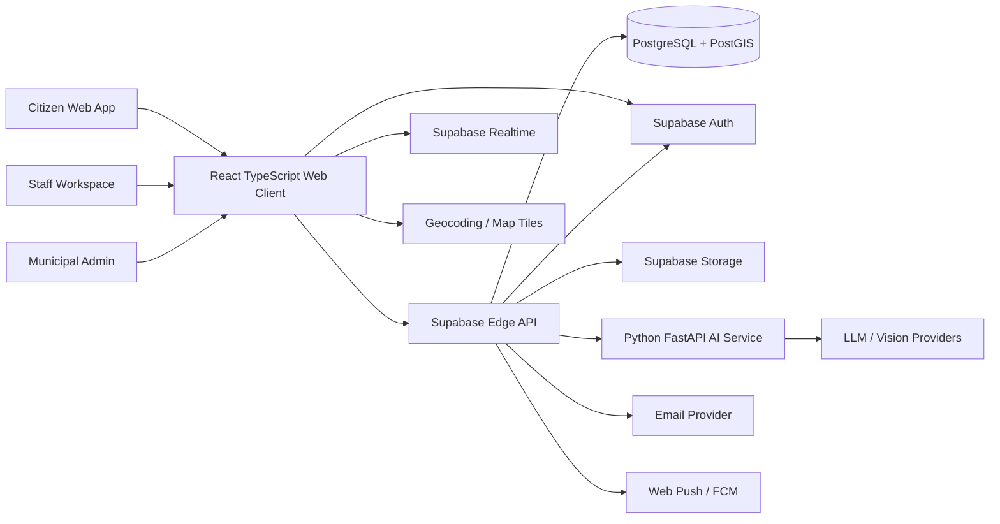
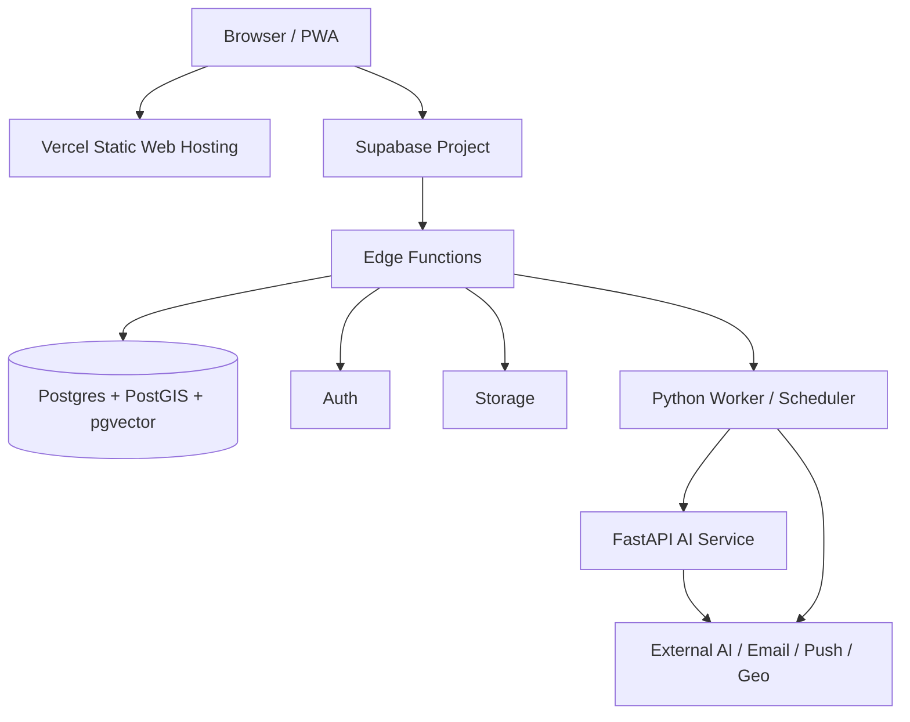

# CivicPulse AI — High-Level Design (HLD)

**Version:** 1.0 draft  
**Date:** 2026-10-30  
**Status:** Proposed architecture for review; no implementation in this phase.

## 1. Purpose and scope

CivicPulse AI is a multi-tenant civic issue intake, triage, dispatch, repair and accountability platform for citizens and municipal organizations. Citizens report public infrastructure defects with photos, descriptions and locations. Municipal teams validate, assign, work and resolve reports. AI provides decision support, never final legal or operational authority.

Initial geography is India. The data model must support multiple municipalities, wards and departments without assuming a single city.

## 2. Architecture principles

1. PostgreSQL is the sole system of record.
2. Modular monolith first; extract services only for independent scaling or ownership.
3. API-first, versioned contracts.
4. AI provider independence through adapters and normalized outputs.
5. Human review for severity overrides and complaint closure.
6. Fail open for civic intake when AI is unavailable; never fabricate AI results.
7. Least privilege, RLS and server-side authorization.
8. Durable asynchronous jobs for long-running work.
9. Auditability for every privileged workflow transition.
10. Design for observability, privacy, accessibility and localization.

## 3. Context and actors

- Citizen/resident: creates and follows complaints, comments, votes and receives updates.
- Field staff: inspects assigned issues, records work and submits repair evidence.
- Department manager: dispatches and supervises department workload.
- Municipal administrator: manages city-wide operations, departments, wards, policies and reports.
- Platform operator: manages tenant provisioning, provider configuration and platform health.
- External providers: AI inference, geocoding/maps, email and web push.

## 4. System context diagram

## 5. Logical architecture

### Presentation
React + TypeScript + Vite. Feature areas: auth, citizen reporting, issue discovery, maps, staff dispatch, repair review, administration, notifications and analytics. Use a shared API client, typed contracts, route guards for UX only, and server-side enforcement for security.

### API/application
Supabase Edge Functions (Deno/TypeScript) expose versioned endpoints. Organize source into domain modules: identity, organizations, reports, media, assignments, workflow, engagement, AI orchestration, notifications, analytics and audit. The Edge Function is a thin transport/application boundary; business rules should be pure functions or services with test coverage.

### AI service
Python FastAPI container exposes authenticated task endpoints. It performs image decoding/quality checks, provider orchestration, output normalization and model provenance recording. Provider adapters implement common interfaces for vision, language and embeddings. Heavy inference must not run in the Edge Function.

### Data
Supabase-managed PostgreSQL + PostGIS is canonical. Supabase Auth owns credentials/identity. `profiles` references `auth.users`. Storage holds binary media; PostgreSQL holds metadata and object paths. pgvector is optional for semantic duplicate search after embedding model choice.

### Async processing
Use a durable job/outbox pattern in PostgreSQL initially, with a worker process for AI tasks, notification deliveries and SLA escalations. Supabase Realtime broadcasts database changes; it is not the durable job queue.

## 6. Deployment view

## 7. Domain module responsibilities

| Module | Owns | Must not own |
|---|---|---|
| Identity | Profiles, role assignments, access checks | Password storage |
| Organization | Tenants, departments, wards, teams | User credentials |
| Report | Civic issue lifecycle and public details | AI provider-specific formats |
| Media | Media metadata, upload policies, retention | Raw binary in SQL |
| AI orchestration | Task routing, retries, provider metadata | Final municipal decisions |
| Vision | Image quality, defect evidence and repair comparison | Complaint status authority |
| Priority | Explainable urgency calculation | Model confidence as urgency |
| Duplicate | Candidate generation and review outcomes | Silent distance-only merging |
| Dispatch | Assignments, work logs, SLA | User authentication |
| Engagement | Comments, votes, bookmarks | Staff-only internal notes |
| Notification | Preferences, outbox, delivery state | Synchronous request critical path |
| Analytics | Aggregated metrics and exports | Unauthorized cross-tenant reads |
| Audit | Append-only actor/action history | Mutable business state |

## 8. Core workflows

### Report intake
Client validates basic fields -> API verifies request and rate limit -> media is uploaded under controlled path -> issue is inserted with `submitted` state -> outbox job schedules AI triage and duplicate candidate generation -> user receives report ID. If AI fails, issue remains valid and triage state becomes `unavailable` or `failed_retryable`.

### Triage
Worker claims job -> loads image from storage -> invokes selected vision adapter -> validates schema and numeric bounds -> stores immutable analysis record -> derives explainable priority recommendation -> flags low confidence for human review -> emits event and notification.

### Dispatch
Department manager validates issue -> assignment is created -> staff receives notification -> staff accepts/starts work -> work logs and status events are recorded. Every transition is authorized by tenant and department scope.

### Repair verification
Staff uploads after-photo -> verification job compares before/after -> AI returns evidence and uncertainty -> staff reviews evidence -> authorized staff confirms resolved or requests more work -> audit event and citizen notification are written atomically.

## 9. Quality attributes and initial targets

| Attribute | Target / design |
|---|---|
| Availability | 99.5% monthly initial objective; dependent on managed providers |
| API latency | P95 < 500ms for ordinary indexed read/write paths, excluding uploads and AI |
| AI latency | Async; provider-dependent; never blocks issue persistence |
| Scale | Stateless web/API; independent worker/AI scaling |
| Security | RLS + tenant-scoped RBAC + server-side policy checks |
| Durability | Managed DB backups; define RPO/RTO before public launch |
| Observability | Correlation IDs, structured logs, provider latency/error metrics |
| Accessibility | WCAG 2.2 AA target |
| Localization | English and Hindi initially; locale-aware dates/numbers |
| Data privacy | Minimize personal data; define retention, deletion and media visibility |
| Recovery | Retryable jobs, dead-letter state, idempotency and documented restore test |

## 10. Technology decisions

| Concern | Decision | Rationale / caveat |
|---|---|---|
| Frontend | React + TypeScript + Vite | Existing React investment; introduce TS incrementally |
| UI | Tailwind CSS + accessible component primitives | Fast consistent responsive UI; current app package does not yet declare Tailwind |
| API | Supabase Edge Functions | Existing production path; suitable for short request orchestration |
| Core DB | Supabase PostgreSQL | Existing canonical production store |
| Spatial | PostGIS | Radius/ward/geometry queries |
| Vector | pgvector, optional | Reuse Postgres for embeddings after model/dimension freeze |
| AI service | Python FastAPI | Existing vision code and Python ML ecosystem |
| Maps | MapLibre GL JS | Open-source rendering; tile/geocoding service is separate procurement decision |
| Storage | Supabase Storage | Existing integration; use private-by-default for non-public content |
| Realtime | Supabase Realtime | Database change subscriptions; not a queue |
| Hosting | Vercel + Supabase + container host | Matches existing deployment split |

## 11. System boundaries and decisions

- The legacy Express/Mongoose service is not a production source of truth. It must not be reconnected to the production frontend without a migration plan.
- The current AI Edge fallback endpoint is not approved as a production provider until independently verified.
- Supabase Edge Functions have bounded CPU/memory/duration; image model inference belongs in a container/provider, not CPU-heavy Edge code.
- MapLibre is a renderer, not a tile/geocoding provider. Provider policy and attribution must be explicit.
- Public OSM tile and Nominatim endpoints are not unrestricted production APIs.

## 12. Risks

| Risk | Mitigation |
|---|---|
| AI hallucination / misclassification | Conservative prompts, schema validation, human review, feedback evaluation |
| Provider outage / quota exhaustion | Adapter fallback, circuit breaker, async retry, manual triage |
| Cross-tenant data leakage | tenant_id on owned rows, RLS tests, server authorization |
| Public image privacy exposure | separate public/private buckets, upload classification, signed access |
| Duplicate false merges | candidate workflow, explainable score, staff/citizen confirmation |
| Cost growth | quotas, per-provider budgets, image downsampling, model routing |
| Geocoding/tiles throttling | provider abstraction, caching, self-host/paid fallback |
| Monolithic API drift | domain modules, contracts, integration tests |
| Large image processing load | container workers, strict image limits, queue backpressure |

## 13. HLD decisions to freeze

HLD-001 PostgreSQL is the only source of truth.  
HLD-002 Supabase Auth is the identity provider.  
HLD-003 Modular monolith first.  
HLD-004 Edge Functions handle request orchestration, not heavy inference.  
HLD-005 Python FastAPI owns AI/vision adapters.  
HLD-006 All AI results are advisory and provenance-recorded.  
HLD-007 Human staff confirmation is mandatory to resolve issues.  
HLD-008 Tenant and department scope is enforced in database and API.  
HLD-009 AI/notification jobs use durable asynchronous processing.  
HLD-010 External providers are replaceable through adapters.

## 14. Out of scope for this phase

No application feature implementation, schema deployment, production configuration, provider key provisioning, model training or live service deployment is performed in Phase 0–4.
