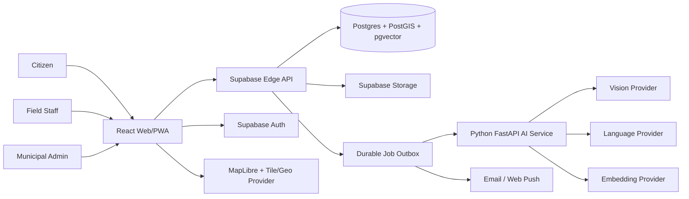

# CivicPulse AI — Target High-Level Design

**Version:** 1.0 · **Date:** 2026-10-30 · **Status:** proposed target-state design.

> Read [00-project-audit.md](./00-project-audit.md) and [01-hld.md](./01-hld.md) first for the observed production baseline. This document describes the broader full-product target, not the currently deployed architecture.

## 1. Product scope

A multi-tenant civic reporting and municipal operations platform for citizens, field staff, department managers, municipal administrators and platform operators. Core journey: report → validate → AI triage → duplicate candidate review → dispatch → field work → repair evidence → human-confirmed resolution → citizen feedback.

## 2. Architecture decisions

1. Supabase PostgreSQL/PostGIS is the only system of record.
2. Supabase Auth owns identity; application profile and tenant memberships extend it.
3. React + TypeScript frontend; Vite build; accessible responsive design.
4. Supabase Edge Functions are the API facade and short orchestration layer.
5. Python FastAPI container owns vision/model adapter execution.
6. Durable DB outbox + worker handles AI, notification and SLA jobs.
7. MapLibre is the map renderer; tile, geocoding and routing providers remain replaceable.
8. Modular monolith first; split deployables only for independent scaling/ownership.
9. AI outputs are advisory; only authorized municipal staff can close a report.
10. Tenant and department scope is enforced in SQL RLS and trusted API authorization.

## 3. Context architecture

## 4. Module boundaries

| Module | Responsibilities |
|---|---|
| Identity & access | profiles, memberships, role/scope checks |
| Organization | municipalities, departments, wards, staff membership |
| Reports | civic issue intake, public detail, lifecycle |
| Media | object storage, visibility, retention, metadata |
| AI orchestration | capability routing, fallback, budget, provenance |
| Vision | photo quality, defect triage, repair comparison |
| Priority | explainable scoring, policy versioning, staff override |
| Duplicate intelligence | spatial/text/image candidates and review |
| Dispatch | assignment, acceptance, work logs |
| Engagement | public comments, votes, bookmarks |
| SLA & escalation | deadlines, timers, escalations |
| Notifications | outbox, preferences, channel delivery |
| Analytics | tenant-scoped aggregates and exports |
| Audit | append-only privileged action history |

## 5. Runtime and deployment

- Vercel: static frontend/PWA.
- Supabase: Auth, PostgreSQL/PostGIS, Storage, Realtime, Edge Functions.
- Container host: FastAPI AI adapter and async worker.
- External providers: vision/LLM/embedding, tiles/geocoding, email/push, abuse protection and observability.
- Secrets live only in trusted runtime secret stores.
- Dev/staging/prod are separate environments; migrations promote through staging before production.

## 6. Core flows

### Report intake
Validate user/tenant/category/location/media → create issue transactionally → enqueue AI and duplicate jobs → return report ID immediately. AI outage never blocks persistence.

### Triage
Worker claims job with lease → loads private media → invokes capability-compatible provider → validates normalized result → stores model/provider/prompt provenance → computes explainable priority recommendation → flags uncertain results for human review.

### Dispatch and resolution
Manager assigns within department/ward scope → staff accepts and records work → staff uploads after evidence → AI compares images → authorized reviewer approves/rejects → issue status, audit event and notification outbox commit together.

## 7. Non-functional requirements

- Initial availability objective: 99.5% monthly, subject to provider plans.
- P95 <500 ms for indexed ordinary API operations (not uploads or inference).
- AI and notification tasks asynchronous and retryable.
- WCAG 2.2 AA target; English/Hindi launch localization.
- All critical mutations auditable and idempotent.
- Tenant isolation tested with cross-tenant adversarial fixtures.
- Explicit RPO/RTO, retention and incident response before public launch.

## 8. Risks and controls

| Risk | Control |
|---|---|
| Provider outage/quota | adapters, health, budget, async retry, manual review |
| AI hallucination | schema validation, confidence calibration, evidence and human approval |
| Duplicate false merge | candidate-only detection; explicit merge review |
| Tenant leakage | tenant_id FKs, RLS, server scope checks and adversarial tests |
| Public media leakage | private-by-default buckets; deliberate public publishing |
| OSM throttling | cache and provider switch; no public tile SLA assumption |
| Cost growth | quotas, image resizing, per-tenant budget and provider routing |

## 9. Architecture decisions to approve

HLD-T01 Postgres is the only source of truth.  
HLD-T02 Multi-tenant municipality boundary.  
HLD-T03 Edge API + Python AI service.  
HLD-T04 Durable outbox for async work.  
HLD-T05 Provider adapters by task capability.  
HLD-T06 Staff confirmation required for resolution.  
HLD-T07 Media private by default, public only after policy decision.  
HLD-T08 Department/ward scope enforced at database and API layers.
