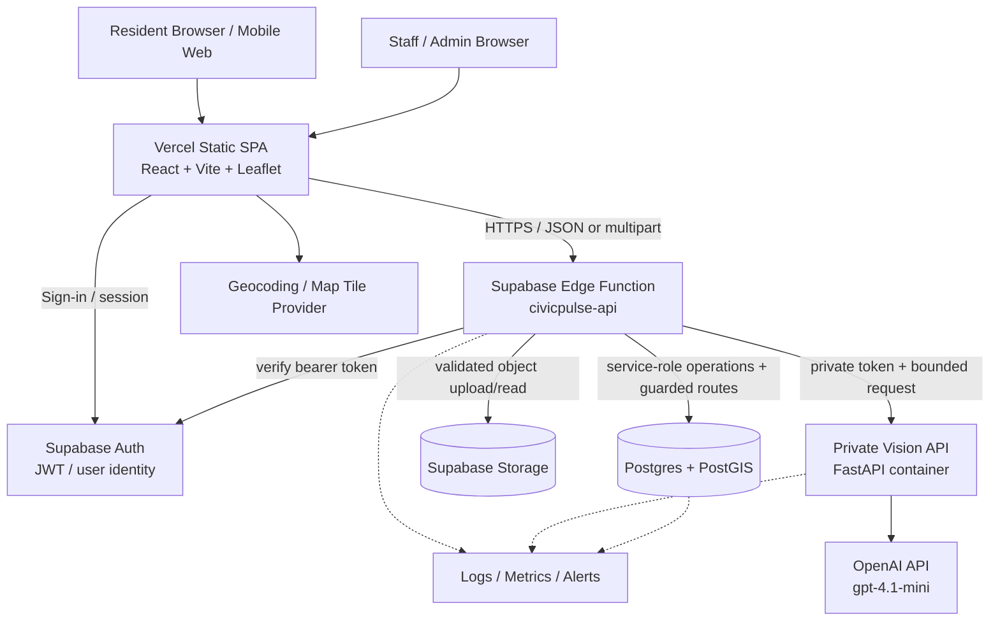
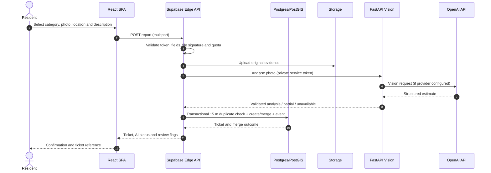

# 01 — High-Level Design (HLD)

**Version:** 1.0 — 2026-10-30  
**Status:** Proposed target architecture for the Phase 0–4 design baseline. Existing and proposed elements are labelled separately.

## 1. Purpose and design goals

CivicPulse provides a transparent workflow from resident observation to municipal action:

**Report → Validate → Analyse → Consolidate → Triage → Assign → Work → Submit evidence → Human-confirm resolution.**

The system should:
- Make a structured, location-aware report possible on mobile and desktop.
- Treat AI output as evidence/triage assistance, never as a decision-maker for public safety or final resolution.
- Consolidate likely duplicate reports without erasing the provenance of the reporter's contribution.
- Give authenticated staff an auditable ticket lifecycle.
- Protect identity, location, image and staff data through least privilege and retention controls.
- Remain operable when AI/geocoding providers are down; user report intake must not fabricate an AI result.

## 2. Architecture decisions

| Concern | Decision | Rationale |
|---|---|---|
| Frontend | React 18 + Vite + Tailwind + Leaflet on Vercel | Existing production frontend and deployment |
| API façade | Supabase Edge Function (Deno/TypeScript) | Existing live API; one trusted server boundary |
| Identity | Supabase Auth | Existing profile FK and JWT validation |
| System of record | Supabase Postgres + PostGIS | Live production data; spatial duplicate query |
| Binary storage | Supabase Storage | Existing 8 MiB photo bucket; harden privacy model |
| Vision runtime | Python FastAPI container, separately hosted | Existing image pipeline; heavier Python/OpenCV/Torch dependencies |
| Vision model | OpenAI `gpt-4.1-mini` via official API, provider abstraction | Current FastAPI code config; model supports image input |
| Realtime | Supabase Realtime (future approved path) or bounded polling | Legacy Socket.IO is not connected to production UI |
| Legacy API | Express/Mongoose excluded from production | Prevent split-brain persistence |
| External geocoding/tiles | Replace or contractually qualify public OSM services for production | Public endpoints are best effort / policy constrained |

## 3. Logical component view



**Trust boundaries**
1. Browser is untrusted. Validate every field/file again on the server.
2. Edge Function is a privileged boundary because its server-side client uses service role. It must authenticate/authorize every non-public operation and never forward that key.
3. Vision container accepts only a private service token and must not be directly callable by browsers.
4. OpenAI key exists only in the vision runtime's secret store; never in Vercel `VITE_*` variables.
5. DB RLS is the backstop for direct client/database access. Edge function handlers still need explicit authorization because service role bypasses RLS.

## 4. Runtime responsibilities

### 4.1 Web client (Vercel)
- Present landing, report, map and command-center workflows.
- Capture image and location after explicit user action/permission.
- Resize and preview safely; provide keyboard-accessible input alternatives.
- Call Edge endpoints using JSON or multipart requests.
- Render priority/confidence plus limitations and human-review status.
- Use short-lived signed URLs for non-public evidence in the recommended privacy configuration.
- Avoid direct browser calls to providers requiring privileged API keys.

### 4.2 Edge API (Supabase)
- Route request, check method/size/content type/schema.
- Identify caller via Supabase Auth token for protected actions.
- Enforce resident/staff/admin role and workflow transition policy.
- Apply report/AI/chat abuse limits.
- Upload/download evidence via Storage.
- Invoke spatial deduplication RPC transactionally.
- Persist issues, comments, votes and immutable events.
- Call the vision service with a short-lived deadline and correlation ID.
- Return explicit partial/unavailable states when AI is down.
- Emit safe logs and metrics; never log bearer tokens or image bodies.

### 4.3 Database
- Keep users/profile roles and tickets as canonical structured records.
- Use PostGIS geography and a GIST index for proximity search.
- Maintain issue lifecycle/audit, comments, votes and technical rate limits.
- Enforce constraints and RLS at the database boundary.
- Record model/provider/version provenance with the decision/evidence.
- Use transaction-safe state transitions and immutable event history.

### 4.4 Vision service
- Validate actual image bytes, dimensions and decoding; reject malformed/oversized images.
- Calculate deterministic photo quality metrics.
- Ask a vision model for a constrained category/evidence response.
- Validate all model-generated data (taxonomy, score ranges, bounding boxes, strings).
- Return confidence, limitations and mandatory human-review flag.
- Compare before/after evidence conservatively; return an advisory recommendation only.
- Provide authenticated `/health`, `/analyze`, `/verify-resolution` and `/chat` endpoints.
- Never store user photos unless a separately approved retention requirement exists.

## 5. Deployment topology

| Component | Environment | Deployment decision |
|---|---|---|
| Web | Vercel production project `civicpulse-ai-production` | Vite build, root `frontend-app`, output `dist` |
| API | Supabase project `ccrhdrjywnaccthzyjte` | Edge Function `civicpulse-api` |
| DB | Supabase Mumbai | Postgres/PostGIS/Auth |
| Object storage | Supabase Storage | Recommend private-by-default; public renditions only after policy decision |
| Vision | Dedicated Docker host (Render blueprint exists) | Deploy only after secrets, health, capacity and privacy review |
| Model | OpenAI API | Server-side secret and budget/rate limit |
| Geocoding/maps | OSM public endpoints currently used | Keep for constrained prototype; production provider decision required |

Vercel is the SPA hosting target, not the long-running Python service. The current `render.yaml` is a proposed Render service, not proof of a deployed service.

## 6. Report workflow (target)



At scale, separate the fast acceptance path from slow inference with a durable job queue/outbox. Do not return a successful classification before the provider returns a validated result. If AI fails, save a manual-review ticket with explicit status.

## 7. Staff resolution workflow (target)

```mermaid
sequenceDiagram
  actor S as Staff
  participant UI as Command Center
  participant API as Edge API
  participant DB as Postgres
  participant Store as Storage
  participant AI as Vision API

  S->>UI: Open assigned ticket
  UI->>API: POST after-repair evidence
  API->>API: Authenticate and check staff role
  API->>DB: Read ticket and before-image path
  API->>Store: Read before image and store after image
  API->>AI: Compare before/after (bounded request)
  AI-->>API: Evidence assessment / inconclusive
  API->>DB: Persist evidence assessment and submission event
  API-->>UI: AI recommendation; still not Resolved
  S->>UI: Confirm or manual override with review note
  UI->>API: POST resolution confirmation
  API->>DB: Atomic status transition + resolved audit event
  API-->>UI: Resolved ticket and audit reference
```

## 8. Quality attributes / non-functional goals

Targets below are **proposed pilot acceptance objectives**, not measured current performance.

| Attribute | Design requirement | Initial acceptance target |
|---|---|---|
| Availability | Degrade gracefully if AI/map provider fails | Report can be accepted for manual triage when AI is unavailable |
| Latency | Keep UI and API bounded; avoid synchronous long model waits | p95 non-AI read/write API < 1.5 s under pilot load; AI path < 45 s or asynchronous acceptance |
| Security | TLS, JWT, RLS, server-only secrets, least privilege | No unreviewed public write path; role/RLS tests pass |
| Privacy | Minimize and control precise location and images | Privacy decision, retention schedule, consent and image access policy signed off |
| Integrity | Atomic lifecycle transition and append-only event | Every successful status change has exactly one event |
| AI safety | Structured output, thresholds, abstention and human review | 100% of AI outputs carry model/source/version and review flag |
| Observability | Request IDs, metrics, logs and provider health | Alert on API error/latency, quota, AI failure, DB/storage errors |
| Scalability | Spatial indexes, paginated API, controlled inference concurrency | Pilot load-test at agreed concurrent usage and image throughput |
| Accessibility | Keyboard/contrast/screen-reader and mobile | WCAG 2.2 AA audit target for key resident/staff flows |

## 9. Architecture risks and mitigations

- **Privileged service-role API:** keep the key only in Edge secrets; add route-level authorization tests for each method/path.
- **Open public images:** switch to private storage or explicit public renditions after a documented publication/retention decision.
- **Provider dependency:** use a provider adapter and circuit breaker; return `partial/unavailable`, never fake AI output.
- **Synchronous inference:** timeouts and cold starts can make report UX unreliable; separate acceptance and analysis jobs when queue capability is selected.
- **Public maps/geocoding:** public OSM services are not a free production SLA; comply with policy or use a contracted provider.
- **Duplicate race:** lock the spatial decision scope, then write/merge in one DB transaction.
- **Single large Edge Function:** separate route modules/shared validators now; split deployments only when operational complexity justifies them.

## 10. Explicit out-of-scope decisions for this phase

No feature implementation, model training, city/department integration, payment, notification, public map-provider contract, database migration, storage policy change, secret update, container deployment, Vercel deployment or live-data mutation is part of this HLD.
