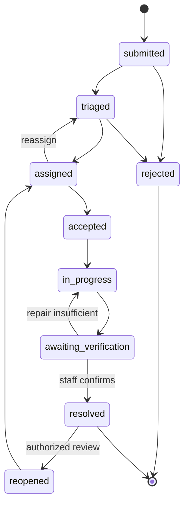

# CivicPulse AI — Low-Level Design (LLD)

**Version:** 1.0 draft · **Date:** 2026-10-30  
**Status:** Proposed contract and workflow design. API routes are logical contracts, not claims that all endpoints currently exist.

## 1. Conventions

- Base path: `/api/v1`
- IDs: UUID
- Timestamps: RFC 3339 UTC
- Coordinates: WGS84; API order is `latitude, longitude`; GeoJSON order is `longitude, latitude`.
- JSON request/response; multipart for media upload.
- Pagination: cursor-based `?limit=25&cursor=...`; max limit 100.
- Every request receives/propagates `X-Request-Id`.
- Mutating endpoints accept `Idempotency-Key` where retry duplication is possible.
- Error envelope:

```json
{
  "error": {
    "code": "VALIDATION_ERROR",
    "message": "The request contains invalid fields.",
    "request_id": "uuid",
    "details": [{"field": "category_id", "issue": "required"}]
  }
}
```

## 2. Actors and authorization

| Role | Scope | Allowed actions |
|---|---|---|
| citizen | own profile; public tenant issues | create report, view public issue, manage own comments/votes, follow own report |
| staff | assigned department/ward and assigned issues | inspect, work log, upload repair evidence, propose status changes |
| department_admin | assigned department/wards | triage, assign staff, manage department queue, approve resolution |
| municipal_admin | municipality | manage departments/wards/staff, policies, all municipal reports and analytics |
| platform_admin | platform tenant provisioning | manage tenant configuration and platform operations |

Role checks are not sufficient alone: every staff action must also satisfy tenant and resource scope.

## 3. Feature specifications

### 3.1 Authentication and profile
- Supabase Auth handles credentials, verification, recovery and sessions.
- On auth-user creation, create a profile with default `citizen` role.
- Role assignment occurs only through trusted administrative workflow.
- Profile fields: display name, phone (optional), preferred locale, avatar path, notification preferences.
- Never accept role, tenant membership or verification flags from ordinary client profile updates.

### 3.2 Tenant and organization
- Municipality is tenant boundary.
- A tenant owns departments and wards.
- A staff member can belong to one or more departments/wards through membership tables.
- Tenant is derived from trusted membership and resource ownership, not from a client-supplied arbitrary tenant ID.

### 3.3 Citizen report intake
Required: tenant, category, description, point location, at least one photo (configurable by category), consent/visibility acknowledgement.
Optional: address label, ward suggestion, contact preference.
Validation:
- description 10–3000 characters;
- image JPEG/PNG/WebP; max 8 MiB per file and configurable count;
- coordinates valid WGS84;
- category active in tenant;
- location must fall in tenant jurisdiction or be explicitly routed to triage.
Process: create report as `submitted`; media metadata stored; enqueue AI triage and duplicate search; return report ID without waiting for AI.
Response includes `triage_status` and `analysis_status` separately from report workflow status.

### 3.4 AI image analysis
Input contract:
```json
{
  "task_id": "uuid",
  "tenant_id": "uuid",
  "issue_id": "uuid",
  "media": [{"object_path": "tenant/issue/file.jpg", "role": "initial"}],
  "requested_category": "pothole",
  "locale": "en-IN"
}
```
Normalized output:
```json
{
  "status": "completed",
  "provider": "provider-id",
  "model": "model-version",
  "task": "civic_defect_triage",
  "category_prediction": {"code": "pothole", "confidence": 0.81},
  "severity_prediction": {"level": "high", "confidence": 0.62},
  "damage_coverage_pct": 24.5,
  "safety_risk": true,
  "evidence": [{"label": "road surface cavity", "bbox_xyxy_norm": [0.1,0.2,0.7,0.8]}],
  "summary": "Visible cavity in road surface.",
  "recommended_action": "Field inspection recommended.",
  "human_review_required": true,
  "limitations": ["Model output is an estimate."]
}
```
Reject malformed/non-finite values and unknown categories. Store raw provider metadata only when it contains no secrets or unnecessary personal data. Preserve model/version and prompt version.

### 3.5 Priority recommendation
Compute a transparent rules score, independent of model confidence:
- category base weight;
- severity estimate;
- declared safety risk;
- affected-person estimate if corroborated;
- age/SLA breach;
- corroborating report count.
Return score, level, reason codes and policy version. Staff can override only with a reason; store old/new score and actor.

### 3.6 Duplicate candidates
Candidate generation uses:
- same tenant and active status;
- same/related category;
- configurable spatial radius (15m initial candidate radius, not automatic merge);
- recent time window;
- text similarity;
- optional image/text embeddings.
Store score components and candidate status. Merge requires staff or citizen-confirmation policy and creates an explicit relation; preserve original reports and authors.

### 3.7 Comments and votes
- Public comments are visible to permitted viewers; internal staff notes use a separate table and policy.
- One active vote per user per issue; changing vote updates same row.
- Soft-delete or moderation state for comments.
- Rate-limit writes; sanitize/render plain text safely.
- Notify issue owner only according to preferences.

### 3.8 Dispatch and work
- Assignment records include tenant, department, issue, assignee, assigner, due date and state.
- Staff can accept/reject with reason; manager can reassign.
- Work logs are append-only.
- Status transition must be validated server-side and recorded as issue event in same transaction.

### 3.9 Repair evidence and verification
- Staff uploads after-media as private object by default.
- Verification task links original and after evidence.
- Output: `likely_repaired`, confidence, score, visible change, evidence, image comparability and human-review flag.
- Staff confirms or rejects with review note.
- No model result directly updates issue to `resolved`.

### 3.10 Notifications
- Write notification intent to outbox in same DB transaction as business event.
- Worker sends email/push/in-app; delivery state is tracked independently.
- Retry transient failures with exponential backoff and jitter; dead-letter permanent failures.
- Respect user preference, tenant policy and quiet hours.

### 3.11 Analytics
- Define metric formulas centrally.
- Use tenant/department filters from trusted context.
- Dashboard uses aggregates/materialized views; avoid downloading all issue rows.
- Export jobs are asynchronous and permission-checked.

## 4. Issue lifecycle state machine



Transitions require role/scope and reason rules. `analysis_status` is independent: queued, processing, completed, partial, unavailable, failed.

## 5. API catalog

| Method | Endpoint | Auth | Purpose |
|---|---|---|---|
| POST | `/auth/profile/bootstrap` | user | ensure profile after signup |
| GET/PATCH | `/me` | user | read/update safe profile fields |
| GET | `/tenants/{tenantId}/categories` | public/user | active categories |
| POST | `/issues` | citizen | create issue metadata and enqueue work |
| GET | `/issues` | public/user | filtered, cursor-paginated issue feed |
| GET | `/issues/{id}` | public/user | issue details, visibility checked |
| PATCH | `/issues/{id}` | owner/admin, limited fields | edit allowed report fields |
| POST | `/issues/{id}/media` | owner/staff | request upload or register media |
| POST | `/issues/{id}/comments` | user | add public comment |
| POST | `/issues/{id}/votes` | user | create/update vote |
| DELETE | `/issues/{id}/votes/me` | user | remove own vote |
| POST | `/issues/{id}/assignments` | department_admin+ | assign staff |
| PATCH | `/assignments/{id}` | assignee/manager | accept/reject/reassign |
| POST | `/issues/{id}/work-logs` | assigned staff | record work |
| POST | `/issues/{id}/repair-evidence` | assigned staff | upload evidence and enqueue verification |
| POST | `/verifications/{id}/decision` | department_admin+ | approve/reject AI suggestion |
| POST | `/issues/{id}/transitions` | scoped staff/admin | validated workflow transition |
| GET | `/maps/issues` | public/user | bounded viewport query |
| GET | `/notifications` | user | own notifications |
| PATCH | `/notifications/{id}/read` | owner | mark own notification read |
| GET | `/admin/overview` | municipal_admin+ | dashboard aggregates |
| CRUD | `/admin/departments`, `/admin/wards` | municipal_admin | organization management |
| GET | `/analytics/reports` | scoped admin | analytics and export job |
| GET | `/health/live`, `/health/ready` | appropriate | health checks |

### Example create issue request
```json
{
  "tenant_id": "uuid",
  "category_id": "uuid",
  "description": "Large pothole near the bus stop.",
  "location": {"type": "Point", "coordinates": [77.5946, 12.9716]},
  "address_label": "Example Road",
  "media": [{"object_path": "tenant-id/pending/upload-id.jpg", "content_type": "image/jpeg"}],
  "locale": "en-IN"
}
```

### Example response
```json
{
  "id": "uuid",
  "reference_code": "CP-2026-000123",
  "status": "submitted",
  "analysis_status": "queued",
  "created_at": "2026-10-30T06:00:00Z"
}
```

## 6. Error codes

| HTTP | Code | Meaning |
|---|---|---|
| 400 | VALIDATION_ERROR | malformed or invalid fields |
| 401 | UNAUTHENTICATED | no valid user session |
| 403 | FORBIDDEN | role/scope does not permit action |
| 404 | NOT_FOUND | resource missing or intentionally concealed |
| 409 | STATE_CONFLICT | transition or idempotency conflict |
| 413 | FILE_TOO_LARGE | upload exceeds configured limit |
| 415 | UNSUPPORTED_MEDIA | media type/signature rejected |
| 422 | BUSINESS_RULE_FAILED | valid syntax but domain rule fails |
| 429 | RATE_LIMITED | quota exceeded |
| 502 | PROVIDER_ERROR | upstream provider failure |
| 503 | TEMPORARILY_UNAVAILABLE | service unavailable; intake should remain possible |
| 500 | INTERNAL_ERROR | unexpected error with request ID |

## 7. Async job contract

Job fields: id, tenant_id, type, payload, idempotency_key, status, attempts, max_attempts, available_at, locked_at, locked_by, last_error_code, created_at, completed_at.

Statuses: queued, processing, retry_wait, succeeded, failed, dead_letter.

Workers claim jobs using transactional row locking (e.g. SKIP LOCKED), bounded concurrency and leases. Every handler must be idempotent.

## 8. Frontend page/component map

- Public: landing, issue feed, issue detail, map, sign-in, registration, recovery.
- Citizen: dashboard, create report wizard, my reports, saved reports, notifications, profile.
- Staff: assigned queue, issue inspection, work log, repair evidence, verification review.
- Department admin: dispatch board, team workload, SLA queue.
- Municipal admin: overview, live map, issue explorer, staff, departments, wards, categories, policies, analytics, audit, provider health.
- Shared: responsive shell, navigation, permission-aware actions, upload widget, map, timeline, status badge, filters, table, chart, empty/error/loading states.

## 9. Non-functional implementation rules

- Validate at client and server; server is authoritative.
- Use optimistic UI only for reversible low-risk actions.
- Use transactions for state changes + events + outbox.
- Never store raw images in database rows.
- Avoid returning internal provider error text to citizens.
- Keep provider secrets server-side.
- Apply tenant filters in every query and RLS policy.
- Use signed URLs for private media.
- Ensure pagination and viewport bounding on all list/map endpoints.
