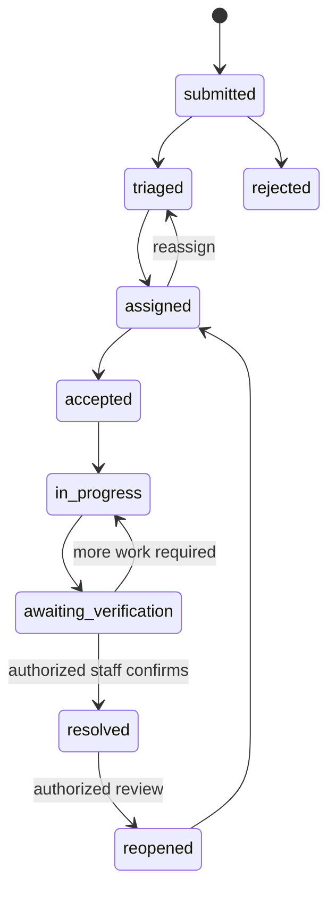

# CivicPulse AI — Target Low-Level Design

**Version:** 1.0 · **Date:** 2026-10-30 · **Status:** proposed target state.

> Current-state endpoints and behavior are catalogued in [02-lld.md](./02-lld.md). This target LLD expands the product to multi-tenant operations and async processing.

## 1. Actors and authorization

| Role | Scope | Actions |
|---|---|---|
| citizen | own profile; public issues in allowed tenant | submit, follow, comment, vote, bookmark |
| staff | assigned issues and membership wards/departments | inspect, accept, work log, evidence upload |
| department_admin | department and scoped wards | triage, assign, reassign, approve repair |
| municipal_admin | entire municipality | organization, categories, SLA, staff, analytics |
| platform_admin | platform | tenant provisioning and platform configuration |

A role without resource scope is insufficient. Resolve tenant and department permissions from trusted membership, never from arbitrary client fields.

## 2. Report creation

Required: tenant, category, description, WGS84 point and media per category policy. Validate image signature, MIME, dimensions, size, count, category active state and jurisdiction. Create issue, initial media metadata, event and outbox job in a transaction. Return without waiting for AI.

Example:
```json
{
  "tenant_id":"uuid",
  "category_id":"uuid",
  "description":"Large pothole near the bus stop",
  "location":{"type":"Point","coordinates":[77.5946,12.9716]},
  "media":[{"object_path":"tenant/issue/upload.jpg","content_type":"image/jpeg"}],
  "locale":"en-IN"
}
```

Response:
```json
{"id":"uuid","reference_code":"CP-2026-000123","status":"submitted","analysis_status":"queued"}
```

## 3. AI task contract

Input: task_id, tenant_id, issue_id, object paths, requested category, locale and prompt version.

Normalized output:
```json
{
  "status":"completed",
  "provider":"provider-id",
  "model":"model-version",
  "task":"civic_defect_triage",
  "category_prediction":{"code":"pothole","confidence":0.81},
  "severity_prediction":{"level":"high","confidence":0.62},
  "damage_coverage_pct":24.5,
  "safety_risk":true,
  "evidence":[{"label":"road cavity","bbox_xyxy_norm":[0.1,0.2,0.7,0.8]}],
  "summary":"Visible road-surface cavity",
  "recommended_action":"Field inspection recommended",
  "human_review_required":true,
  "limitations":["Model estimate; staff decision required"]
}
```

Reject non-finite numbers, invalid bounding boxes, unknown category codes and provider responses outside schema. Store provider/model/prompt version and latency.

## 4. Priority calculation

Compute from category policy, severity, corroborated safety risk, damage coverage, age/SLA and verified impact signals. Confidence is a reliability signal, not an urgency multiplier. Persist score, level, reason codes and scoring-policy version. Staff overrides require reason and audit event.

## 5. Duplicate detection

Candidate features: spatial distance, same/related category, submission time, text similarity and optional image/text embedding similarity. Initial 15m radius is a candidate-generation default only. Store component scores and review state. Never auto-merge solely on distance.

## 6. Workflow state machine



Analysis state is separate: queued, processing, completed, partial, unavailable, failed.

## 7. API catalog

Base path: `/api/v1`.

| Method | Route | Authorization |
|---|---|---|
| GET/PATCH | `/me` | authenticated user; safe fields only |
| GET | `/tenants/{id}/categories` | public/user |
| POST | `/issues` | citizen membership |
| GET | `/issues`, `/issues/{id}` | public visibility or authorized scope |
| PATCH | `/issues/{id}` | owner, editable state, allowlisted fields |
| POST | `/issues/{id}/media` | owner or scoped staff |
| POST | `/issues/{id}/comments` | authenticated user |
| POST/DELETE | `/issues/{id}/votes` | own vote |
| POST | `/issues/{id}/assignments` | department_admin+ |
| PATCH | `/assignments/{id}` | assignee or manager |
| POST | `/issues/{id}/work-logs` | assigned staff |
| POST | `/issues/{id}/repair-evidence` | assigned staff |
| POST | `/verifications/{id}/decision` | department_admin+ |
| POST | `/issues/{id}/transitions` | scoped staff/admin |
| GET | `/maps/issues` | public/user; bounded viewport |
| GET/PATCH | `/notifications` | own notifications |
| GET | `/admin/overview` | municipal_admin+ |
| CRUD | `/admin/departments`, `/admin/wards` | municipal_admin |
| GET | `/analytics/reports` | scoped admin |
| GET | `/health/live`, `/health/ready` | platform policy |

Every mutation uses request validation, stable error codes, request ID, audit and idempotency where applicable. Standard error envelope: `{error:{code,message,request_id,details}}`.

## 8. Async job model

Job fields: id, tenant_id, job_type, payload, idempotency_key, status, attempts, max_attempts, available_at, locked_at, locked_by, last_error_code, created_at, completed_at.

Statuses: queued, processing, retry_wait, succeeded, failed, dead_letter. Workers claim with transactional row locks/leases; handlers are idempotent. Realtime is a notification channel, not the durable queue.

## 9. UI route inventory

Public: landing, issue feed/detail, map, sign-in, registration, recovery.  
Citizen: dashboard, report wizard, my reports, bookmarks, notifications, profile.  
Staff: assigned queue, issue inspection, work logs, repair upload, verification.  
Department admin: dispatch board, workload, SLA queue.  
Municipal admin: command center, map, issues, staff, departments, wards, categories, SLA, escalations, analytics, audit, provider health.

## 10. Error mapping

400 validation; 401 unauthenticated; 403 forbidden; 404 not found/concealed; 409 state/idempotency conflict; 413 file too large; 415 unsupported media; 422 business rule; 429 rate limited; 502 provider error; 503 temporary unavailable; 500 unexpected with request ID.

## 11. Test requirements

Unit: validation, priority, duplicate score, transition graph, provider normalization.  
Integration: auth, RLS, report, upload, assignment, comments/votes, outbox and verification.  
Security: cross-tenant read/write, role escalation, malicious media, token replay, rate limit.  
E2E: citizen submit → triage → assignment → work → evidence → human approval → notification → dashboard metric.
