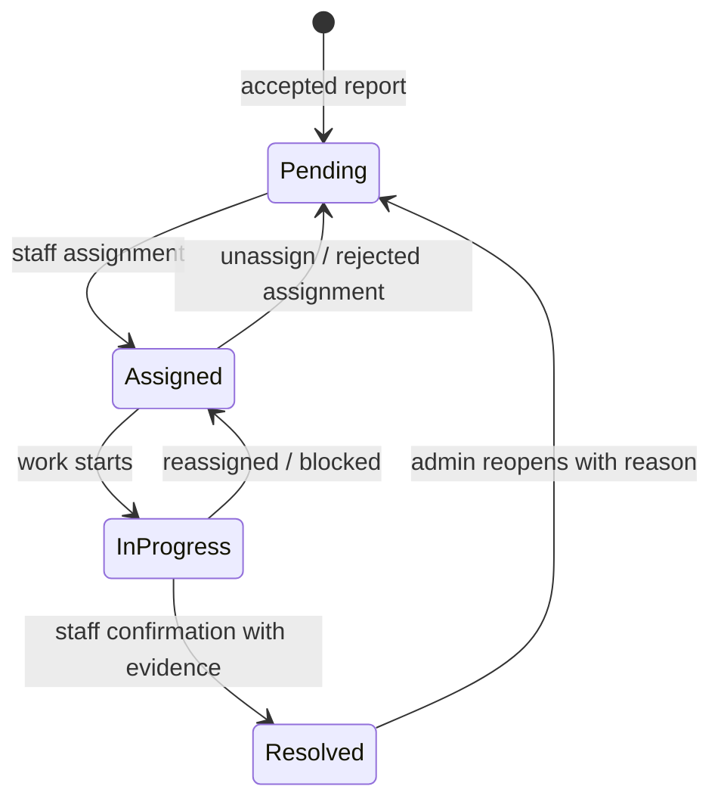

# 02 — Low-Level Design (LLD)

**Version:** 1.0 — 2026-10-30  
**Scope:** Design the currently evidenced resident, staff, AI and data flows; mark proposed hardening as recommendations.

## 1. Module decomposition

| Module | Responsibility | Current implementation |
|---|---|---|
| Public web | Landing, workflow explanation, report entry | `frontend-app/src/App.jsx` |
| Resident reporting | Photo, category, description, location, confirmation | React report page |
| Command center | Ticket list/map/status/comment/vote and staff controls | React command center |
| Client API adapter | Base URL, token header, multipart and JSON | Shared `apiBase` in app source |
| Edge API router | Request routing, CORS, response envelope | `supabase/functions/civicpulse-api/index.ts` |
| Authentication | Token validation and profile lookup | `currentUser()`, `requireStaff()` |
| Issue service | Intake, list, dedupe, status and detail | Edge function + Postgres RPC |
| Evidence service | Validate/upload and retrieve before/after evidence | Edge function + Storage |
| AI adapter | Vision/chat calls, fallback, model output parsing | Edge function and FastAPI service |
| Database | Profiles/issues/events/comments/votes/rate limit | Supabase Postgres |
| Legacy API | Old Mongo CRUD and Socket.IO | `backend-service`; not in production flow |

Target code organization (design only): keep routes thin and place request schemas, role policy, issue service, AI provider adapter, storage service, audit service and error mapping in separate modules. Do not add a parallel Express production API.

## 2. API contract inventory

Base URL:

`https://ccrhdrjywnaccthzyjte.supabase.co/functions/v1/civicpulse-api`

Every request should return JSON with a consistent `request_id`, stable error `code`, safe `message` and optional `details` (never a stack trace or secret). Existing API response envelopes are not completely uniform; standardize in a later contract change.

| Method | Path | Auth | Request / behavior | Current evidence |
|---|---|---|---|---|
| GET | `/health` or `/api/health` | Public | API/database/AI configured status | Edge source |
| GET | `/api/ai/health` | Public | AI provider mode and availability summary | Edge source |
| GET | `/api/me` | Optional bearer | Authenticated profile/role or unauthenticated result | Edge source |
| GET | `/api/tickets` | Public | List issues; status/zone/defect/min-priority filters | Edge source |
| POST | `/api/tickets/report` | Optional bearer | Multipart photo + category + description + latitude/longitude + landmark | Edge source |
| POST | `/api/ai/analyze` | Optional bearer | Multipart image + category; pre-submit assistive analysis | Edge source |
| GET | `/api/tickets/:id/comments` | Authenticated | Read comments | Edge source |
| POST | `/api/tickets/:id/comments` | Authenticated resident/staff/admin | JSON `{body}`, 1–2000 chars | Edge source |
| GET | `/api/tickets/:id/events` | Authenticated | Read history | Edge source |
| POST | `/api/tickets/:id/vote` | Authenticated | Toggle current user's vote | Edge source |
| PATCH | `/api/tickets/:id/status` | Staff/admin | JSON `{status}`; cannot directly set Resolved | Edge source |
| POST | `/api/tickets/:id/resolve` | Staff/admin | Multipart after-repair image; compare with before evidence | Edge source |
| POST | `/api/tickets/:id/resolve/confirm` | Staff/admin | JSON confirmation; manual override requires review note | Edge source |
| POST | `/api/chat` | Optional bearer | JSON `{message}`, 1–2000 chars; live ticket context | Edge source |

### 2.1 Report request schema

- `image`: required file; JPEG/PNG/WebP; 1 byte–8 MiB; inspect file signature and decoded image, not only the Content-Type.
- `defect_type`: `pothole | garbage | sewage | streetlight | unknown`.
- `description`: trimmed string, 5–2000 characters.
- `latitude`: finite number, -90 to 90.
- `longitude`: finite number, -180 to 180.
- `landmark`: optional, max 200 characters.
- Identity: bearer JWT optional; anonymous reporter persists as NULL.
- Server: rate limit 5 reports/hour per resolved user/IP identity.
- Response: ticket, `merged`, `ai_status`, message; status 201 for new issue, 200 for merge.

### 2.2 AI analysis response contract (target normalized shape)

```json
{
  "status": "success | partial | unavailable",
  "provider": "openai | approved-provider | none",
  "model": "provider-model-version",
  "prompt_version": "civic-triage-v1",
  "defect_type": "pothole | garbage | sewage | streetlight | unknown",
  "confidence": 0.0,
  "severity": "LOW | MEDIUM | CRITICAL",
  "priority_score": 0,
  "damage_coverage_pct": 0,
  "summary": "string",
  "visible_evidence": ["string"],
  "recommended_action": "string",
  "human_review_required": true,
  "bounding_boxes": [{"label":"string","confidence":0.0,"bbox":[0,0,1,1]}],
  "image_quality": {"quality":"good | review | poor","quality_flags":[]},
  "limitations": ["string"]
}
```

All numeric values must be finite and bounded. Bounding boxes must be normalized to 0–1 with x2>x1 and y2>y1. Unknown model labels map to `unknown`; they must never be coerced into a supported category without evidence. The system must be able to abstain. Priority score is a triage aid, not a legal or medical safety assessment.

## 3. Role and permission matrix

| Action | Anonymous | Resident | Staff | Admin |
|---|---:|---:|---:|---:|
| View public issue list/map | Yes | Yes | Yes | Yes |
| Create report | Yes (unclaimed) | Yes (owned) | Yes | Yes |
| View account profile | No | Own profile | Own profile | Own profile |
| Vote/comment | No | Yes | Yes | Yes |
| View events | No | Yes | Yes | Yes |
| Change issue status | No | No | Yes | Yes |
| Assign issue | No | No | Yes (target policy) | Yes |
| Upload after-repair evidence | No | No | Yes | Yes |
| Confirm AI/manual resolution | No | No | Yes | Yes |
| Promote roles / manage providers | No | No | No | Trusted admin operation only |

The live DB lets signed-in users read all profiles and all comments/events/votes. Public issue reads expose ticket fields. The target should reduce columns/rows to necessary data and use explicit views or API projections, not `select *`, especially for AI metadata and image paths.

## 4. Ticket lifecycle and transitions

Permitted target state machine:



Current enum labels are `Pending`, `Assigned`, `In Progress`, `Resolved`. Enforce transitions in a database transaction/RPC, not solely in the frontend. Store actor, old/new status, assignment target, reason and correlation ID in one event. For reopening, add an explicit approved transition and event type only after product confirmation.

Current issue: status PATCH writes `assigned_to = auth.user.id` on every status update, not only when status becomes Assigned. Target semantics should separate assignment from status transition and accept a validated `assignee_id` or use a dedicated assignment action.

## 5. Detailed workflow rules

### 5.1 Intake

1. UI obtains user consent for browser geolocation; manual pin/search remains available.
2. Client compresses/limits photo for mobile. Server validates bytes, MIME, image decoding, dimensions, pixel count and maximum size.
3. Edge authenticates optional JWT; derives a trustworthy IP address from platform-provided headers only.
4. Apply report quota (currently 5/hour/account or IP) and anti-bot policy.
5. Store immutable original under random UUID path; never accept client-supplied object path.
6. Run vision classification with a strict provider timeout. Persist provider/model/prompt version, status, confidence, output hash and latency.
7. Invoke a transactional PostGIS duplicate merge function.
8. Commit new/merged issue and event atomically; return a durable ticket ID and AI status.
9. If AI is unavailable, accept valid report as manual review only if risk/abuse checks pass; do not fabricate category confidence or score.

**Concurrency requirement:** current nearest-row `SELECT ... FOR UPDATE` does not serialize two inserts if neither sees a candidate. A category/location-scoped advisory-lock strategy or a tested serializable transaction is required. A first-cut lock by category is correct but low throughput; a spatial-cell lock strategy requires neighboring-cell locking to avoid edge misses.

### 5.2 Duplicate merge

Current rule: same defect category, not Resolved, within 15 metres, closest candidate. The new submission increments `upvote_count`, `report_frequency`, `duplicate_count`, and creates a merged event.

Target requirements:
- Keep an immutable report/submission identity and relationship to the canonical issue, so separate citizen reports are not lost.
- Only merge if category, distance, time window and issue status satisfy approved rules.
- Never merge solely on AI label when confidence is below the agreed threshold.
- Do not overwrite original report evidence or reporter identity.
- Return `merged_into_issue_id` and distance so the UI can explain the result.
- Add an idempotency key for retries so network timeouts cannot create duplicate contributions.
- Write merge and counters in a single transaction.

### 5.3 AI vision and priority

- Pre-process EXIF rotation and downsample; strip EXIF/GPS before provider upload unless location metadata is explicitly required and consented.
- Run photo-quality metrics and reject unreadable images or request another image.
- Vision provider returns candidate category, evidence phrases, confidence and bounding boxes.
- Validate output against a strict JSON schema; do not rely on JSON parsing alone.
- Calculate priority from a documented deterministic policy (category weight, visible damage, safety-risk flag, location/criticality only if verified). Keep model confidence separate from priority.
- Show the user the estimate and human-review label. Staff can override with reason.
- Retain only the minimum provider input/output and model metadata needed for audit; configure retention and access.

No labelled Indian urban civic image dataset, per-category precision/recall or calibration evidence was found. The current generic YOLO model is contextual only; it is not a validated pothole/sewage/streetlight classifier.

### 5.4 Resolution evidence

- Staff uploads a genuine after image for an issue with an existing before image.
- Server retrieves original before image and submits both to a vision model.
- A passing result is advisory and includes confidence, comparison evidence, before/after damage estimates and limitations.
- Staff reviews the photo and confirms. Failed/inconclusive AI can be overridden only with a required review note (current minimum length 10).
- Final status and `resolved` audit event must commit atomically. The live schema currently rejects `resolved`; this must be fixed before relying on resolution audit history.

### 5.5 Chat

- Keep chat scope civic: issue submission help, allowed ticket status, process questions and approved city FAQs.
- When live issue context is supplied, retrieve only safe aggregate or explicitly authorized issue data.
- The model must not claim to have created, changed or resolved a ticket unless a tool/action completed and returned an ID.
- Limit message length and rate (currently 20/hour), use prompt-injection-resistant context boundaries, and refuse to reveal resident personal data.
- Add citations to official municipal rules only if a trusted knowledge source is later integrated; the current project has no grounded municipal knowledge base.

## 6. Error and resilience model

| Error | HTTP target | Client behavior |
|---|---:|---|
| Malformed input / invalid coordinates | 400 | Inline correction |
| Missing/invalid session for protected action | 401 | Re-authenticate |
| Insufficient role | 403 | Explain staff-only control |
| Issue not found | 404 | Refresh list |
| State conflict / missing before evidence | 409 | Explain required workflow |
| Upload too large / unsupported image | 413 / 415 | Re-capture or convert |
| Quota exceeded | 429 + Retry-After | Show reset guidance |
| AI provider timeout / unavailable | 200 partial for report acceptance; 503 for optional direct AI call if appropriate | Manual review state |
| DB/storage outage | 503 | Preserve draft and retry safely with idempotency key |
| Unexpected failure | 500 with request ID | Generic message; secure server log |

Do not silently downgrade a security, permission or data-integrity failure to a successful result. Only AI failure may degrade to manual review; data-write failure must remain an error.

## 7. Database access patterns

- Ticket board: keyset/cursor pagination by `created_at DESC, id DESC`; filters use status, category, zone, assigned staff and priority.
- Map: use bounding box or viewport filtering and cap returned records; cluster on client or server.
- Nearby duplicate: `ST_DWithin(geography, geography, 15)`, GiST index, same category and non-resolved; lock before search/insert.
- Issue timeline: `issue_events(issue_id, created_at DESC)`.
- Comments: `issue_comments(issue_id, created_at ASC)`, page newest or oldest as required.
- Votes: composite PK `(issue_id,user_id)`; return `has_voted` for current user.
- Rate limit: atomic upsert; expire old buckets on a scheduled cleanup.
- Avoid broad `select *` on public API. Explicitly omit `ai_metadata`, internal paths, reporter identity and private notes from public response schemas.

## 8. Security design

1. Publishable Supabase key only in frontend; service role and OpenAI/vision tokens only in secret stores.
2. For public function routes keep platform JWT verification disabled only where anonymous access is required; every protected route validates the caller token and checks the DB role. Add negative route tests.
3. Prefer private Storage with policies by issue ownership/staff role. Generate expiring URLs for media views; public map thumbnails, if required, should be a deliberate redacted rendition.
4. Maintain RLS on every exposed table. Validate role policy using JWT `app_metadata` or database-controlled role source, not mutable user metadata.
5. Harden Auth with password strength/leaked-password controls (where plan allows), CAPTCHA and rate limits.
6. Restrict CORS to approved production/preview origins; wildcard only with a documented public-only/no-cookie threat assessment.
7. Apply field-level projection/minimization to public ticket routes.
8. Protect audit trail from direct user mutation; state-changing endpoints append event in the same transaction.
9. Redact provider errors, image EXIF and user identifiers from logs.
10. Adopt data retention, deletion, incident response, and staff access review processes.

## 9. Observability and operations

Every request should carry a UUID correlation ID. Record:
- route, status, duration, request ID, safe actor class, release version;
- upload bytes and validation outcome (never image body);
- AI provider/model/version, status, latency, token usage/cost where available, fallback reason;
- DB read/write/query duration and duplicate match outcome;
- quota rejection counts, CAPTCHA failures, auth failures;
- status transition/event consistency.

Alert on Edge/DB/Storage failures, provider error spikes, excessive 429s, missing AI configuration, queue backlog (if later adopted), and failed event persistence. Define an on-call owner and an incident playbook before a public launch.

## 10. Test strategy

**Unit:** input schemas, image signature and decoded limits, EXIF rotation/strip, output JSON schema, score bounding, bbox normalization, state-transition rules, provider fallback and timeout.

**Database:** migrations from empty schema; role/RLS tests for anon/resident/staff/admin; event type constraint; transactional state change + audit; concurrent duplicate reports; concurrent vote counter; rate-limit boundary and bucket cleanup; FK/delete behavior; PostGIS distance boundary.

**API integration:** every endpoint from the contract table, missing/malformed/expired JWT, role escalation attempts, public intake, anonymous/user quota, storage policy and service token enforcement.

**E2E:** resident reports with image/location; duplicate report merge; staff assign/start; evidence upload; positive AI advice and manual override; final event history; AI-unavailable manual flow; provider outage; mobile accessibility.

**Release gate:** all P0 defects closed; no secrets in client bundle; DB migration status clean; no unresolved security advisor finding accepted without a compensating control; smoke tests pass against a non-production environment; production deploy commit traceable.

## 11. Assumptions and pending design approvals

- The primary pilot is India-based; exact municipal jurisdiction, ward/department taxonomy, languages and legal retention requirements are not specified.
- Anonymous public reports remain allowed unless owner chooses account-required intake.
- Photos are currently treated as public by deployment docs; target privacy posture is private-by-default pending approval.
- Model scores are not considered ground truth.
- No payment, citizen identity verification (Aadhaar or similar), WhatsApp integration, SMS/email notification or municipal ERP integration is assumed.
