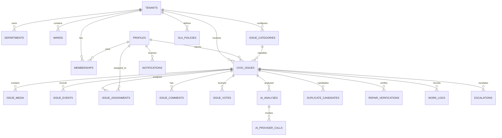

# CivicPulse AI — Target Database Design

**Version:** 1.0 · **Date:** 2026-10-30 · **Status:** proposed multi-tenant extension.

> [03-erd.md](./03-erd.md) and [04-database-sql-design.sql](./04-database-sql-design.sql) describe the current production model/reference DDL. This document describes the expanded target domain. It is not a statement that these tables already exist.

## 1. Principles

- UUID primary keys; UTC timestamptz.
- Every municipal business entity is tenant-scoped.
- Supabase Auth remains identity authority; profiles reference auth.users.
- PostGIS geography(Point,4326) for issue coordinates and geometry(MultiPolygon,4326) for ward boundaries.
- Storage contains binaries; DB contains object paths and metadata.
- Events, work logs, provider calls and audit entries are append-only.
- AI analysis stores provider/model/prompt provenance.
- RLS and server authorization both enforce tenant and department/ward scope.

## 2. Entity inventory

| Domain | Tables | Key design |
|---|---|---|
| Tenant | tenants | municipality, slug, locale, timezone, active |
| Identity | profiles | auth user FK, safe profile fields |
| Organization | departments, wards, memberships | tenant-scoped membership and role |
| Categories | issue_categories | tenant code, default department, policy weights |
| Reports | civic_issues, issue_media, issue_events | category, reporter, location, status, visibility |
| Dispatch | issue_assignments, work_logs | department, assignee, due date, work history |
| Engagement | issue_comments, issue_votes, bookmarks | unique user/issue vote |
| AI | ai_analyses, ai_provider_calls | immutable result and provider telemetry |
| Duplicate | duplicate_candidates, issue_relations | candidate score, decision, provenance |
| Repair | repair_verifications | before/after media, model suggestion, human decision |
| SLA | sla_policies, escalations | tenant/category/priority targets |
| Notifications | notifications, notification_deliveries, notification_preferences, device_tokens | recipient, channel, delivery attempts |
| Operations | job_outbox, idempotency_records, audit_logs | durable tasks, replay protection, audit |

## 3. ERD

## 4. Important constraints and indexes

- `tenants.slug` unique.
- `departments(tenant_id, code)`, `wards(tenant_id, code)`, `issue_categories(tenant_id, code)` unique.
- Composite foreign keys include tenant_id to prevent cross-tenant references.
- `issue_votes(issue_id,user_id)` unique.
- `issue_media(bucket_id,object_path)` unique.
- `duplicate_candidates(issue_id,candidate_issue_id)` unique and issue IDs must differ.
- `civic_issues(tenant_id,status,created_at desc)` B-tree.
- GiST index on issue location and ward boundary.
- Partial index on unresolved due items and queued jobs.
- GIN full-text index on normalized description if required.
- pgvector only after embedding model and dimensions are frozen; HNSW/IVFFlat selected by measured workload.

## 5. RLS model

A trusted helper resolves membership by auth.uid(), tenant_id and active role. Policies:
- Public: read only explicitly public issues, visible comments and public media.
- Citizen: own profile, own reports, own comments/votes/notifications.
- Staff: tenant + assigned department/ward + assignment scope.
- Department admin: department scope, assignments and approvals.
- Municipal admin: all data within their tenant.
- Platform admin: privileged service-only platform operation.
- Job outbox, provider logs, audit logs and delivery attempts: no direct client writes.
- Storage object policies mirror issue media visibility; private media uses signed access.

Do not rely on RLS alone for workflow transitions. State changes go through a trusted API/RPC that validates role, scope, transition, writes event and outbox atomically.

## 6. SQL design references

- [Current-state SQL reference](./04-database-sql-design.sql)
- [Transactional RPC reference](./04a-database-rpc-design.sql)
- [Target core schema draft](./sql/001_civicpulse_core.sql)
- [Target RLS policy draft](./sql/002_rls_policy_design.sql)

All are design artifacts. Reconcile actual migrations, run against a disposable Supabase project, inspect query plans and test RLS before any production change.
