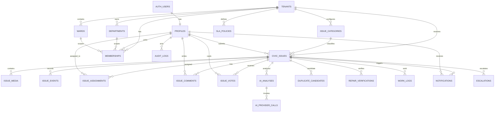

# CivicPulse AI — Database Design

**Version:** 1.0 draft · **Date:** 2026-10-30  
**Engine:** PostgreSQL + PostGIS; pgvector optional after embedding model freeze.  
**Canonical data store:** Supabase PostgreSQL.

## 1. Design rules

- Every tenant-owned business row has `tenant_id`.
- User identity remains in `auth.users`; app profile references it.
- UUID primary keys; UTC `timestamptz`.
- Foreign keys use explicit delete behavior.
- Spatial coordinates use PostGIS SRID 4326.
- Binary media is stored in Supabase Storage; SQL stores object paths and metadata.
- Append-only records for events, work logs, provider calls and audit.
- Use RLS for data access; Edge Function authorization supplements it.
- AI outputs are immutable snapshots with provider/model/prompt provenance.
- Do not make AI confidence the priority score.

## 2. ERD

## 3. Table catalog

| Table | Purpose | Important constraints/indexes |
|---|---|---|
| tenants | municipality/tenant boundary | unique slug |
| profiles | app profile for auth user | FK auth.users, safe profile fields |
| departments | municipal departments | unique tenant + code |
| wards | ward/zone boundaries | tenant + code; optional polygon GiST |
| memberships | role and org scope | unique user/tenant/department/ward tuple |
| issue_categories | configurable defect categories | unique tenant + slug |
| civic_issues | canonical report/ticket | tenant/status/category/created indexes; GiST location |
| issue_media | storage object metadata | unique bucket + object path |
| issue_events | lifecycle timeline | append-only, issue/time index |
| issue_comments | citizen-facing comments | issue/time, moderation state |
| issue_votes | one vote per user per issue | unique issue/user |
| issue_assignments | dispatch records | issue/status and assignee/status indexes |
| work_logs | append-only staff work records | issue/time, staff/time |
| ai_analyses | normalized AI results | issue/time, task/status |
| ai_provider_calls | provider execution telemetry | analysis/time, provider/time |
| duplicate_candidates | candidate evidence and decisions | unique issue pair; score index |
| repair_verifications | before/after model assessment | issue/time, decision state |
| sla_policies | tenant/category priority SLA | tenant/category/priority |
| escalations | overdue/escalation history | issue/status/due time |
| notifications | in-app messages | recipient/created/read |
| notification_deliveries | email/push attempts | status/available_at |
| audit_logs | security/admin audit | tenant/time, actor/time |
| job_outbox | durable async tasks | status/available_at, unique idempotency |
| idempotency_records | replay protection | tenant/key unique |

## 4. Proposed SQL migration

The following is a design baseline. It must be applied only in a disposable/local database for validation before any production migration. Tenant onboarding and production RLS policies require review against actual municipality membership rules.

See `docs/sql/001_civicpulse_core.sql` for the proposed SQL migration.

## 5. Index strategy

- B-tree: `(tenant_id, status, created_at desc)`, `(tenant_id, category_id, created_at desc)`.
- Spatial: GiST on issue location and ward boundary.
- Unique: issue vote `(issue_id, user_id)`; tenant slug; category slug per tenant; object path.
- Partial: unresolved issues, queued jobs, unread notifications.
- Text: GIN tsvector for description/search if PostgreSQL full-text search is selected.
- Vector: HNSW or IVFFlat only after embedding dimensions, distance metric, volume and query workload are known.

## 6. RLS policy model

RLS helper functions should be SECURITY DEFINER only where required, have fixed search_path and minimal grants. Do not use a client-supplied tenant ID as authority.

Policy intent:
- Public users can read only issues explicitly marked public and in an active tenant.
- Citizens can insert reports only for an allowed tenant and can edit only their own reports while in editable states.
- Citizens can read/update their own profile, comments, votes and notifications.
- Staff can read issues only within membership department/ward scope or explicit assignment.
- Department managers can assign staff within their department.
- Municipal admins can manage records within their tenant.
- Platform admins use a separate privileged server-side workflow.
- Audit, provider calls, job outbox and AI provider logs are not directly writable by ordinary clients.
- Storage object access mirrors media visibility and tenant ownership.

RLS tests must attempt cross-tenant and cross-user access for SELECT/INSERT/UPDATE/DELETE.

## 7. Data retention and privacy

- Public issue photos must be clearly labeled as public evidence before upload.
- Private repair evidence and staff-only attachments should use private buckets and signed URLs.
- Do not store EXIF GPS unless explicitly needed and consented.
- Define retention/deletion policy for original media, failed uploads, AI payloads and logs.
- Do not store provider prompts containing personal data unless necessary; redact logs.
- Support user account deletion/anonymization without deleting civic audit records required by law/policy; define legal basis before launch.
