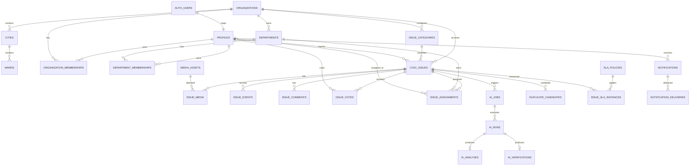

# CivicPulse AI — Database Design and SQL Blueprint
Version 1.0-draft · 2026-10-30 · PostgreSQL + PostGIS

> This is a target design, not a migration to execute. The current project already has a subset of tables and policies. Introspect and back up the actual Supabase schema before writing additive migrations.

## 1. Principles
- PostgreSQL is the single transactional source of truth.
- UUID PKs, timestamptz UTC, explicit FKs/checks/unique constraints.
- Tenant scope (organization/city/department/ward) is explicit.
- PostGIS geography(Point,4326) and GiST indexes for distance operations.
- Store storage bucket/object paths, not permanent public URLs.
- Append-only issue events and audit logs.
- AI results are versioned records, not mutable columns on civic_issues.
- Enable pgvector only after confirming extension availability and selecting an embedding model.
- Minimize PII and use private media by default.

## 2. ER diagram


## 3. Tables and key columns

### Organization
- organizations(id, slug, name, organization_type, country_code, timezone, status, settings, created_at, updated_at)
- cities(id, organization_id, name, state_code, country_code, boundary geography(MultiPolygon,4326))
- wards(id, city_id, code, name, boundary geography(MultiPolygon,4326), is_active)
- departments(id, organization_id, code, name, description, is_active)

### Identity
- profiles(id FK auth.users, display_name, phone_e164, locale, account_status, created_at, updated_at)
- organization_memberships(id, organization_id, profile_id, role_code, status, created_at, updated_at)
- department_memberships(id, department_id, profile_id, role_code, is_active, created_at)
Role grants are scoped memberships; do not rely on one global user role.

### Issue taxonomy and reporting
- issue_categories(id, organization_id nullable for global template, code, name, description, default_department_id, base_priority, requires_photo, is_active, config)
- civic_issues(id, organization_id, city_id, ward_id, category_id, reporter_id nullable, description, landmark, location geography(Point,4326), address_label, status, priority_level, priority_score, priority_policy_version, public_reference, duplicate_of_issue_id, is_public, row_version, submitted_at, created_at, updated_at, resolved_at)
- media_assets(id, owner_profile_id, organization_id, bucket_id, object_path, media_kind, mime_type, byte_size, width, height, sha256, status, visibility, retention_until, created_at, validated_at)
- issue_media(issue_id, media_asset_id, sequence_no, purpose, created_at)
- issue_events(id, organization_id, issue_id, actor_profile_id, event_type, from_status, to_status, note, public_message, metadata, created_at)
- issue_comments(id, issue_id, author_profile_id, body, visibility, moderation_status, created_at, updated_at, deleted_at)
- issue_votes(issue_id, profile_id, vote_type, created_at) PK(issue_id,profile_id)
- issue_bookmarks(issue_id, profile_id, created_at) PK(issue_id,profile_id)

### Workflow
- issue_assignments(id, issue_id, department_id, assigned_profile_id, assigned_by_profile_id, status, due_at, accepted_at, completed_at, reason, created_at)
- staff_work_logs(id, issue_id, assignment_id, staff_profile_id, work_type, description, started_at, ended_at, created_at)
- repair_evidence(id, issue_id, submitted_by_profile_id, media_asset_id, notes, submitted_at)
- resolution_decisions(id, issue_id, reviewer_profile_id, decision, ai_verification_id, reason, created_at)
- sla_policies(id, organization_id, category_id, priority_level, response_minutes, resolution_minutes, business_hours, escalation_policy, version, is_active)
- issue_sla_instances(id, issue_id, sla_policy_id, response_due_at, resolution_due_at, response_met_at, resolution_met_at, state)
- escalations(id, issue_id, sla_instance_id, escalation_level, assigned_to_profile_id, reason, status, created_at, acknowledged_at, resolved_at)

### AI and duplicate
- ai_jobs(id, issue_id, job_type, status, priority, input_payload, idempotency_key, attempts, max_attempts, available_at, locked_at, locked_by, last_error_code, created_at, completed_at)
- ai_runs(id, ai_job_id, provider_id, model_id, prompt_version, status, latency_ms, input_tokens, output_tokens, estimated_cost, error_code, created_at, completed_at)
- ai_analyses(id, ai_run_id, issue_id, category_code, category_confidence, severity, severity_confidence, damage_coverage_pct, priority_recommendation, summary, visible_evidence, recommended_action, bounding_boxes, human_review_required, limitations, created_at)
- ai_verifications(id, ai_run_id, issue_id, before_media_id, after_media_id, outcome, confidence, damage_before_pct, damage_after_pct, evidence, human_review_required, created_at)
- ai_provider_events(id, provider_id, task_type, event_type, status_code, latency_ms, sanitized_metadata, created_at)
- duplicate_candidates(id, source_issue_id, candidate_issue_id, algorithm_version, score, evidence, state, reviewed_by_profile_id, reviewed_at, created_at)
- issue_relations(id, source_issue_id, target_issue_id, relation_type, created_by_profile_id, created_at)
- issue_embeddings(id, issue_id, embedding_model, embedding vector, created_at) only if pgvector enabled and dimensions/model selected.

### Notifications and platform
- notification_preferences(profile_id, channel, event_type, enabled)
- notifications(id, recipient_profile_id, organization_id, event_key, title, body, data, read_at, created_at)
- notification_deliveries(id, notification_id, channel, provider, provider_message_id, status, attempt_count, next_attempt_at, last_error_code, created_at, updated_at)
- device_tokens(id, profile_id, provider, token_hash, encrypted_token, platform, last_seen_at, revoked_at)
- audit_logs(id, organization_id, actor_profile_id, action, resource_type, resource_id, request_id, before_snapshot, after_snapshot, created_at)
- idempotency_records(id, actor_key, idempotency_key, request_hash, response_status, response_body, expires_at, created_at)
- outbox_events(id, aggregate_type, aggregate_id, event_type, payload, status, attempts, available_at, locked_at, created_at, processed_at)
- rate_limit_buckets(bucket_key, window_started_at, request_count, expires_at)
- analytics_snapshots and daily_issue_metrics: organization/city/ward/department/date/category dimensions and aggregate metrics only.

## 4. SQL blueprint (representative core DDL)
```sql
create extension if not exists postgis with schema extensions;
create extension if not exists pgcrypto with schema extensions;
-- Enable only after checking availability:
-- create extension if not exists vector with schema extensions;

create table public.organizations (
 id uuid primary key default gen_random_uuid(),
 slug text not null unique,
 name text not null,
 organization_type text not null check (organization_type in ('municipal_corporation','municipality','platform')),
 country_code char(2) not null default 'IN',
 timezone text not null default 'Asia/Kolkata',
 status text not null default 'active' check (status in ('active','suspended')),
 settings jsonb not null default '{}'::jsonb,
 created_at timestamptz not null default now(),
 updated_at timestamptz not null default now()
);
create table public.profiles (
 id uuid primary key references auth.users(id) on delete cascade,
 display_name text,
 phone_e164 text,
 locale text not null default 'en-IN',
 account_status text not null default 'active' check (account_status in ('active','suspended','deactivated')),
 created_at timestamptz not null default now(),
 updated_at timestamptz not null default now()
);
create table public.organization_memberships (
 id uuid primary key default gen_random_uuid(),
 organization_id uuid not null references public.organizations(id),
 profile_id uuid not null references public.profiles(id),
 role_code text not null check (role_code in ('citizen','staff','department_admin','municipal_admin','platform_admin')),
 status text not null default 'active' check (status in ('invited','active','suspended','revoked')),
 created_at timestamptz not null default now(),
 updated_at timestamptz not null default now(),
 unique(organization_id,profile_id,role_code)
);
create table public.cities (
 id uuid primary key default gen_random_uuid(),
 organization_id uuid not null references public.organizations(id),
 name text not null, state_code text, country_code char(2) not null default 'IN',
 boundary extensions.geography(MultiPolygon,4326),
 created_at timestamptz not null default now(),
 unique(organization_id,name,state_code)
);
create table public.wards (
 id uuid primary key default gen_random_uuid(),
 city_id uuid not null references public.cities(id),
 code text not null, name text not null,
 boundary extensions.geography(MultiPolygon,4326),
 is_active boolean not null default true,
 unique(city_id,code)
);
create table public.departments (
 id uuid primary key default gen_random_uuid(),
 organization_id uuid not null references public.organizations(id),
 code text not null, name text not null, description text,
 is_active boolean not null default true,
 unique(organization_id,code)
);
create table public.issue_categories (
 id uuid primary key default gen_random_uuid(),
 organization_id uuid references public.organizations(id),
 code text not null, name text not null, description text,
 default_department_id uuid references public.departments(id),
 base_priority smallint not null default 20 check(base_priority between 0 and 100),
 requires_photo boolean not null default true,
 is_active boolean not null default true,
 config jsonb not null default '{}'::jsonb,
 unique(organization_id,code)
);
create table public.civic_issues (
 id uuid primary key default gen_random_uuid(),
 organization_id uuid not null references public.organizations(id),
 city_id uuid not null references public.cities(id),
 ward_id uuid references public.wards(id),
 category_id uuid not null references public.issue_categories(id),
 reporter_id uuid references public.profiles(id),
 description text not null check(char_length(trim(description)) between 5 and 2000),
 landmark text,
 location extensions.geography(Point,4326) not null,
 status text not null default 'submitted' check(status in ('submitted','triage_pending','triaged','awaiting_assignment','assigned','in_progress','repair_submitted','verification_pending','resolved','rejected','reopened','cancelled')),
 priority_level text not null default 'low' check(priority_level in ('low','medium','high','critical')),
 priority_score numeric(5,2) not null default 0 check(priority_score between 0 and 100),
 priority_policy_version text not null default 'v1',
 public_reference text not null,
 duplicate_of_issue_id uuid references public.civic_issues(id),
 is_public boolean not null default true,
 row_version bigint not null default 1,
 submitted_at timestamptz not null default now(),
 created_at timestamptz not null default now(),
 updated_at timestamptz not null default now(),
 resolved_at timestamptz,
 unique(organization_id,public_reference)
);
create index civic_issues_org_status_idx on public.civic_issues(organization_id,status,created_at desc);
create index civic_issues_location_gix on public.civic_issues using gist(location);
create table public.media_assets (
 id uuid primary key default gen_random_uuid(),
 owner_profile_id uuid references public.profiles(id),
 organization_id uuid references public.organizations(id),
 bucket_id text not null, object_path text not null unique,
 media_kind text not null, mime_type text not null,
 byte_size bigint not null check(byte_size > 0),
 width integer, height integer, sha256 text,
 status text not null default 'initiated' check(status in ('initiated','uploaded','validated','rejected','deleted')),
 visibility text not null default 'private' check(visibility in ('private','public_derivative')),
 retention_until timestamptz, created_at timestamptz not null default now(), validated_at timestamptz
);
create table public.issue_media (
 issue_id uuid not null references public.civic_issues(id) on delete cascade,
 media_asset_id uuid not null references public.media_assets(id),
 sequence_no smallint not null default 1,
 purpose text not null check(purpose in ('initial_evidence','supporting_evidence','public_derivative')),
 created_at timestamptz not null default now(),
 primary key(issue_id,media_asset_id)
);
create table public.issue_events (
 id uuid primary key default gen_random_uuid(),
 organization_id uuid not null references public.organizations(id),
 issue_id uuid not null references public.civic_issues(id),
 actor_profile_id uuid references public.profiles(id),
 event_type text not null, from_status text, to_status text,
 note text, public_message text, metadata jsonb not null default '{}'::jsonb,
 created_at timestamptz not null default now()
);
create index issue_events_issue_created_idx on public.issue_events(issue_id,created_at desc);
create table public.issue_votes (
 issue_id uuid not null references public.civic_issues(id) on delete cascade,
 profile_id uuid not null references public.profiles(id) on delete cascade,
 created_at timestamptz not null default now(),
 primary key(issue_id,profile_id)
);
create table public.ai_jobs (
 id uuid primary key default gen_random_uuid(),
 issue_id uuid references public.civic_issues(id),
 job_type text not null,
 status text not null default 'queued' check(status in ('queued','running','succeeded','partial','failed','retry_scheduled','dead_lettered','cancelled')),
 priority smallint not null default 0,
 input_payload jsonb not null default '{}'::jsonb,
 idempotency_key text not null unique,
 attempts integer not null default 0, max_attempts integer not null default 3,
 available_at timestamptz not null default now(), locked_at timestamptz, locked_by text,
 last_error_code text, created_at timestamptz not null default now(), completed_at timestamptz
);
create index ai_jobs_claim_idx on public.ai_jobs(status,available_at,priority desc);
create table public.ai_runs (
 id uuid primary key default gen_random_uuid(),
 ai_job_id uuid not null references public.ai_jobs(id),
 provider_id text not null, model_id text not null, prompt_version text not null,
 status text not null, latency_ms integer, input_tokens integer, output_tokens integer,
 estimated_cost numeric(12,6), error_code text, created_at timestamptz not null default now(), completed_at timestamptz
);
create table public.ai_analyses (
 id uuid primary key default gen_random_uuid(),
 ai_run_id uuid not null unique references public.ai_runs(id),
 issue_id uuid not null references public.civic_issues(id),
 category_code text not null,
 category_confidence numeric(5,4) not null check(category_confidence between 0 and 1),
 severity text not null check(severity in ('low','medium','high','critical','unknown')),
 severity_confidence numeric(5,4) check(severity_confidence between 0 and 1),
 damage_coverage_pct numeric(5,2) check(damage_coverage_pct between 0 and 100),
 priority_recommendation numeric(5,2) check(priority_recommendation between 0 and 100),
 summary text, visible_evidence jsonb not null default '[]'::jsonb,
 recommended_action text, bounding_boxes jsonb not null default '[]'::jsonb,
 human_review_required boolean not null default true,
 limitations jsonb not null default '[]'::jsonb, created_at timestamptz not null default now()
);
create table public.duplicate_candidates (
 id uuid primary key default gen_random_uuid(),
 source_issue_id uuid not null references public.civic_issues(id),
 candidate_issue_id uuid not null references public.civic_issues(id),
 algorithm_version text not null,
 score numeric(5,4) not null check(score between 0 and 1),
 evidence jsonb not null default '{}'::jsonb,
 state text not null default 'pending' check(state in ('pending','confirmed','rejected','auto_linked')),
 reviewed_by_profile_id uuid references public.profiles(id),
 reviewed_at timestamptz, created_at timestamptz not null default now(),
 unique(source_issue_id,candidate_issue_id,algorithm_version),
 check(source_issue_id <> candidate_issue_id)
);
create table public.notifications (
 id uuid primary key default gen_random_uuid(),
 recipient_profile_id uuid not null references public.profiles(id),
 event_key text not null, title text not null, body text not null,
 data jsonb not null default '{}'::jsonb, read_at timestamptz,
 created_at timestamptz not null default now(),
 unique(recipient_profile_id,event_key)
);
create table public.audit_logs (
 id uuid primary key default gen_random_uuid(),
 organization_id uuid references public.organizations(id),
 actor_profile_id uuid references public.profiles(id),
 action text not null, resource_type text not null, resource_id uuid,
 request_id uuid, before_snapshot jsonb, after_snapshot jsonb,
 created_at timestamptz not null default now()
);
```

## 5. Index plan
- civic_issues(organization_id,status,created_at DESC)
- civic_issues(organization_id,priority_level,created_at DESC)
- civic_issues(reporter_id,created_at DESC)
- GIST(civic_issues.location)
- issue_events(issue_id,created_at DESC)
- issue_comments(issue_id,created_at DESC) with partial predicate for non-deleted
- issue_assignments(assigned_profile_id,status,due_at)
- ai_jobs(status,available_at,priority DESC)
- duplicate_candidates(candidate_issue_id,state)
- notifications(recipient_profile_id,created_at DESC)
- notification_deliveries(status,next_attempt_at)
- audit_logs(organization_id,created_at DESC)
- outbox_events(status,available_at)
Only add GIN JSONB indexes for paths proven by query plans.

## 6. RLS matrix
- Anonymous: public-safe issue view and public derivative media only; no direct inserts.
- Citizen: public-safe issue fields, own private reports, own profile/votes/bookmarks, public comments.
- Staff: issues within active department/ward assignment scope; internal comments and evidence only in scope.
- Department admin: department scope and assignment management.
- Municipal admin: organization/city scope and configuration.
- Platform admin: audited cross-tenant support only.
- Audit/provider/rate-limit tables: no citizen access.
Use views or RPC DTOs for public fields. Do not expose raw civic_issues rows with reporter identifiers, internal metadata or private media paths. RLS must be tested with anon/citizen/staff/admin JWTs.

## 7. Existing schema migration strategy
1. Snapshot/introspect live Supabase schema and compare it with repository migrations.
2. Create additive organization/city/ward/department tables.
3. Backfill existing data into a verified pilot tenant.
4. Map text defect_type into issue_categories.
5. Move media paths into media_assets with explicit privacy classification.
6. Preserve old status/event history and map statuses explicitly.
7. Add scoped RLS and test policies before switching clients.
8. Add API compatibility DTOs.
9. Remove obsolete columns only after verified cutover and backup.

## 8. Required DB tests
Clean install and upgrade migrations; PostGIS meter distance and coordinate order; cross-tenant denial; citizen cannot alter role/status/priority; staff out-of-scope denial; internal comments hidden; private storage denied; vote uniqueness under concurrency; duplicate candidate integrity; invalid AI numeric values rejected; issue/event/outbox atomicity.
