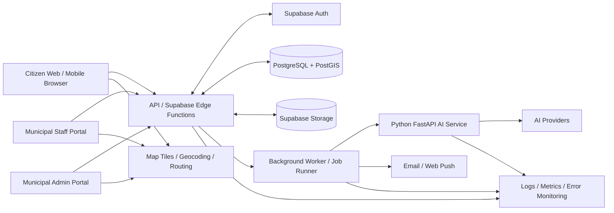

# CivicPulse AI — High-Level Design (HLD)
**Version:** 1.0-draft | **Date:** 2026-10-30 | **Status:** Proposed architecture

## 1. Purpose and scope

CivicPulse AI is a multi-role civic issue intake, triage, dispatch, repair and accountability platform. Citizens report infrastructure problems with images, descriptions and coordinates. AI provides advisory classification and evidence analysis. Municipal staff manage assignments and work. Administrators oversee service levels, geographic patterns and performance.

Target launch geography is India, with a design that supports multiple municipal organizations, cities, wards and departments.

This HLD describes target state. It does not assert that all target components exist today.

## 2. Architecture principles

1. PostgreSQL is the sole system of record for all transactional civic data.
2. Supabase Auth is the identity provider; application authorization is enforced server-side and by RLS.
3. Start with a modular monolith and separate AI inference as a deployable service.
4. Keep provider-specific code behind adapters.
5. Citizen report persistence must not depend on AI provider availability.
6. AI outputs are advisory, explainable and versioned.
7. Staff approval is mandatory for final resolution.
8. All privileged workflow changes create immutable audit events.
9. Use asynchronous jobs for slow/retryable AI, email, push and analytics tasks.
10. Public data, private user data and internal municipal data have distinct access rules.

## 3. Target context diagram

## 4. Deployment view

- **Frontend:** Vercel static/edge hosting for React application.
- **Core backend:** Supabase Auth, PostgreSQL/PostGIS, Storage, Realtime and Edge Functions.
- **AI workload:** Container-hosted Python FastAPI service; GPU is optional and must be justified by chosen model.
- **Background worker:** Container or managed worker for jobs that exceed Edge Function CPU/time constraints.
- **External providers:** AI inference, map tiles/geocoding/routing, email and push.
- **Observability:** Structured logs, provider latency/error metrics and alerting.

Supabase Edge Functions are suitable for short HTTP orchestration and third-party calls; long-running or CPU-heavy tasks should be offloaded to workers. See official Edge Functions docs and runtime limits:
- https://supabase.com/docs/guides/functions
- https://supabase.com/docs/guides/functions/limits

## 5. Logical modules

| Module | Responsibility | Primary data |
|---|---|---|
| Identity & Access | Auth profiles, roles, org scope, permissions | profiles, memberships, role_permissions |
| Organization | Municipal organizations, cities, wards, departments | organizations, cities, wards, departments |
| Issue Intake | Validation, idempotent submission, citizen report | civic_issues, issue_media |
| Media | Upload authorization, metadata, retention, access | media_assets |
| AI Orchestration | Task queue, provider routing, normalized result | ai_jobs, ai_runs, ai_provider_events |
| Vision | Photo quality, defect evidence, repair comparison | ai_analyses, ai_verifications |
| Priority | Transparent risk/urgency scoring | priority_assessments |
| Duplicate Detection | Spatial/text/image candidate ranking | duplicate_candidates, issue_relations |
| Workflow | Assignment, status, SLA, escalation | issue_assignments, issue_events, sla_policies |
| Engagement | Votes, comments, bookmarks | issue_votes, issue_comments, bookmarks |
| Notifications | Preferences, queue, provider deliveries | notifications, notification_deliveries |
| Analytics | Aggregates, trends and exports | analytics_snapshots, daily_issue_metrics |
| Audit | Append-only security/business audit | audit_logs |

## 6. Feature domains

### Citizen
Registration, login, profile, complaint intake, image upload, GPS/manual pin, category, description, status tracking, public map, search/filter, comments, votes, bookmarks, notifications, report sharing.

### AI
Image quality; defect classification; visible evidence; damage coverage estimate; severity/priority recommendation; summary and action; duplicate candidate ranking; semantic search; before/after comparison; civic assistant.

### Staff
Assigned queue, department queue, inspection, assignment acceptance/transfer, work notes, status changes, evidence upload, verification review, resolution decision, escalation and SLA view.

### Administration
Dashboard, map, staffing, departments, wards, category configuration, assignment, SLA, escalations, audit, provider health, analytics, exports and platform settings.

### Platform operations
Health checks, quotas, job retries, dead-letter queue, API key rotation, monitoring, backups, retention and incident response.

## 7. Main system flows

### 7.1 Report intake
1. Client obtains an upload authorization or signed upload URL.
2. Client uploads image to a controlled storage bucket.
3. Client submits issue metadata with idempotency key.
4. API authenticates citizen (anonymous submissions are an explicit policy choice) and validates location/category/description/media ownership.
5. API persists issue and initial event transactionally.
6. API enqueues AI analysis and duplicate candidate jobs.
7. API returns accepted issue ID and processing state.
8. Worker calls AI and duplicate providers, persists results and notifies relevant staff.
9. Report remains valid even when all AI providers fail.

### 7.2 Triage and assignment
1. Rules engine calculates deterministic baseline priority.
2. AI provides advisory severity, evidence and confidence.
3. Staff/department rules and ward mapping identify eligible queues.
4. Authorized staff assigns issue.
5. Assignment and status transitions are recorded as events.
6. SLA clock starts or changes based on configured policy.

### 7.3 Repair and resolution
1. Staff records work log and uploads after-repair evidence.
2. Worker performs before/after comparison.
3. AI returns positive, negative or inconclusive result with evidence.
4. Staff reviews original and repair evidence.
5. Authorized staff confirms or rejects resolution with note.
6. Database transaction changes status and writes audit event.
7. Citizen receives notification.

## 8. State model

Issue lifecycle:
- submitted
- triage_pending
- triaged
- awaiting_assignment
- assigned
- in_progress
- repair_submitted
- verification_pending
- resolved
- rejected
- reopened
- cancelled

State transitions are controlled by server-side workflow rules. AI cannot directly set a terminal state. Reopen and cancellation require reason codes and audit events.

AI job lifecycle:
- queued
- running
- succeeded
- partial
- failed
- retry_scheduled
- dead_lettered
- cancelled

## 9. Technology choices

| Layer | Decision | Rationale / caveat |
|---|---|---|
| UI | React + TypeScript + Vite | Reuse existing React app; type-safe modular frontend |
| Styling | Tailwind CSS | Existing stack |
| Data fetching | TanStack Query | Caching, retries, invalidation and server-state management |
| Forms | React Hook Form + Zod | Consistent validation |
| Maps | MapLibre GL JS | Open WebGL map renderer; map tiles remain a separate provider decision |
| API | Supabase Edge Functions (TypeScript/Deno) | Core short-lived API, auth and orchestration |
| Database | PostgreSQL + PostGIS | Relational integrity and spatial indexing |
| Auth | Supabase Auth | Existing identity integration |
| Files | Supabase Storage | Signed uploads, RLS and resumable uploads |
| AI | Python FastAPI + provider adapters | Python ecosystem and independent inference deployment |
| Jobs | Durable DB outbox + worker initially | Avoid losing tasks; can later move to managed queue |
| Realtime | Supabase Realtime | Database-backed subscriptions; validate event scope |
| Email | Resend adapter candidate | Simple transactional API; requires key and deliverability setup |
| Push | Firebase Cloud Messaging adapter candidate | Web push and device-token support |
| CI | GitHub Actions | Build, lint, typecheck, tests, migration checks |

## 10. Multi-tenancy and geography

Data model must include organization/city scope from the beginning:
- organization_id on operational records;
- city and ward boundaries;
- department membership and staff assignments;
- role and permission scoped to organization/department/ward;
- policies preventing cross-organization reads/writes.

Publicly visible issue fields are explicitly allow-listed. Internal notes, personal data, reporter identifiers, private media and audit details are never exposed by broad public SELECT policies.

## 11. Security architecture

- Supabase Auth JWT validation at API boundary.
- RBAC + organization/department/ward scope.
- RLS for all tables exposed through Data API.
- Service role only in trusted server runtime.
- Signed upload and download policies for private evidence.
- Image signature and decode validation, size/pixel limits.
- Per-account and per-IP throttles with abuse monitoring.
- Idempotency for report creation and workflow actions.
- Strict CORS origin allow-list.
- Secret manager, rotation and least privilege.
- Append-only audit records for privileged changes.
- AI prompts treat image/user text as untrusted content.
- No private user data in AI prompts unless necessary and disclosed.

## 12. Non-functional requirements

Initial targets (to be measured, not claimed as achieved):
- 99.5% monthly availability target for core intake.
- P95 under 500 ms for normal API reads/writes excluding upload and AI.
- Report persistence must succeed independently of AI.
- AI jobs should be asynchronous; target response time depends on provider.
- All workflow transitions transactionally recorded.
- WCAG 2.2 AA target for core citizen flows.
- Mobile-first performance on mid-range Android devices.
- Backups and documented recovery objectives.
- Metrics for latency, error rate, provider quota, queue depth and job age.

## 13. Architecture decisions

- ADR-001: Supabase/Postgres is the single production source of truth.
- ADR-002: Keep Express/MongoDB isolated as legacy; no dual writes.
- ADR-003: Modular monolith plus separate AI service, not premature microservices.
- ADR-004: Asynchronous AI and notification processing.
- ADR-005: Provider adapters and normalized contracts.
- ADR-006: Human confirmation required for resolution.
- ADR-007: Tenant-aware data model from initial redesign.
- ADR-008: Private-by-default media, public derivatives only when appropriate.
- ADR-009: Duplicate matching creates candidates; merge requires review/rules.
- ADR-010: Map renderer and map data provider are separate choices.

## 14. Out of scope for this HLD

Detailed column-level SQL, endpoint schemas, component props, provider prompt formats, exact deployment sizing and implementation code are covered by LLD, Database Design and API Research.

## 15. References

- Supabase Edge Functions: https://supabase.com/docs/guides/functions
- Supabase Edge Function limits: https://supabase.com/docs/guides/functions/limits
- Supabase Storage: https://supabase.com/docs/guides/storage
- Supabase pgvector: https://supabase.com/docs/guides/database/extensions/pgvector
- MapLibre GL JS: https://maplibre.org/maplibre-gl-js/docs/
