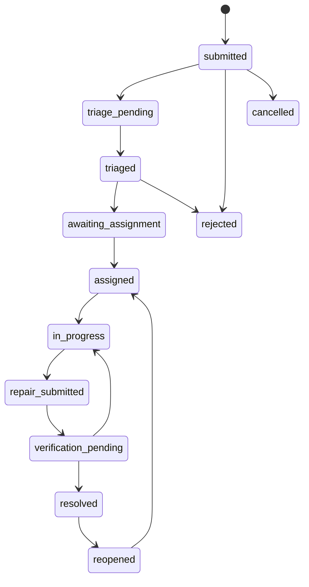
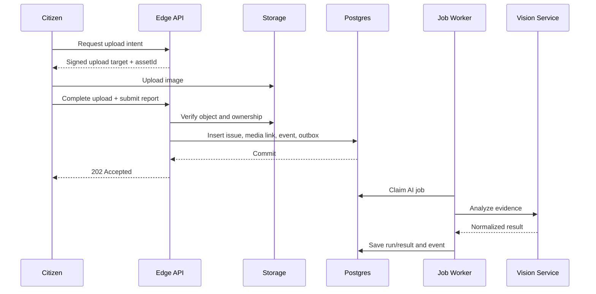

# CivicPulse AI — Low-Level Design
Version 1.0-draft · 2026-10-30 · Proposed target design

## Conventions
- API prefix: /api/v1; JSON camelCase, SQL snake_case.
- UUID identifiers; UTC timestamptz.
- Coordinates are WGS84; API fields latitude/longitude; GeoJSON order is longitude/latitude.
- Cursor pagination for feeds; bounded offset for small admin grids.
- Mutating requests use Idempotency-Key where retries can create duplicates.
- Stable errors: { "error": { "code": "...", "message": "...", "requestId": "...", "details": [] } }.
- Return explicit DTOs; never serialize database rows wholesale.

## Roles and scope
| Role | Scope | Permissions |
|---|---|---|
| citizen | self and public issue data | submit, view public issues, manage own profile, comment, vote, bookmark, view own private details |
| staff | assigned department/ward | inspect, accept assignment, work log, permitted status changes, repair evidence |
| department_admin | department | assign/reassign, manage department queue/staff, escalations |
| municipal_admin | municipal organization/city | staff, departments, wards, SLA, category and city analytics |
| platform_admin | platform | cross-tenant support with audited break-glass access |

RLS and server-side authorization are authoritative. UI route guards are only a UX layer.

## Frontend page/component design
- PublicShell: landing, public report detail, report form, map.
- CitizenShell: My Reports, notifications, profile.
- StaffShell: assigned queue, issue inspection, work log, repair verification.
- AdminShell: command center, departments, wards, staff, SLA, analytics, audit.
- Shared components: AppHeader, Sidebar, IssueCard, IssueStatusBadge, PriorityBadge, MapView, ImageUploader, EvidenceGallery, Timeline, DataTable, FilterBar, ConfirmDialog, EmptyState, ErrorState.
- Feature folders: auth, reports, media, maps, comments, voting, staff-queue, assignments, repair, notifications, admin, analytics.
- All async views implement loading, empty, error, retry, offline and permission-denied states.
- AI output visibly indicates pending/partial/unavailable and advisory status.

## API contracts (proposed; not existing endpoint claims)

### Identity
- Supabase Auth SDK: signup/signin/refresh/signout.
- GET /api/v1/me: current profile and scoped memberships.
- PATCH /api/v1/me: allow-listed profile fields only.

### Reports
- POST /api/v1/reports: category, description, location, landmark, mediaAssetIds. Returns 202 with reportId and job states.
- GET /api/v1/reports: cursor, category, status, priority, bbox, near, createdAfter filters.
- GET /api/v1/reports/{id}: public-safe DTO; private fields only for owner/authorized staff.
- PATCH /api/v1/reports/{id}: owner edits allowed fields only before workflow lock.
- POST /api/v1/reports/{id}/comments; POST/DELETE /api/v1/reports/{id}/votes.
- POST/DELETE /api/v1/reports/{id}/bookmarks.

### Media
- POST /api/v1/media/upload-intents: create owner-bound upload intent.
- POST /api/v1/media/{assetId}/complete: verify object, signature, dimensions and ownership.
- GET /api/v1/media/{assetId}/url: signed URL for authorized access.

### Workflow
- POST /api/v1/reports/{id}/assignments: department admin or municipal admin.
- PATCH /api/v1/assignments/{id}: accept, reject, transfer, complete with reason.
- POST /api/v1/reports/{id}/work-logs.
- POST /api/v1/reports/{id}/repair-evidence.
- POST /api/v1/reports/{id}/resolution-decisions: confirm, reject, needs_more_work, reopen; note required.

### AI
- POST /api/v1/ai/analyses: enqueue analysis, not synchronous long inference.
- GET /api/v1/ai/jobs/{jobId}: status and normalized result.
- POST /api/v1/ai/repair-verifications: enqueue before/after comparison.
- POST /api/v1/assistant/messages: role-scoped grounded assistant, rate-limited.

### Geo, notifications, admin
- GET /api/v1/map/issues?bbox=...
- GET /api/v1/map/heatmap?bbox=...
- GET /api/v1/search
- GET /api/v1/notifications; PATCH /api/v1/notifications/{id}/read
- PUT /api/v1/notification-preferences
- POST/DELETE /api/v1/devices
- GET /api/v1/admin/overview, /staff, /departments, /wards, /sla-policies, /escalations, /audit-logs, /analytics/*

## Example report request
```json
{
  "categoryCode": "pothole",
  "description": "Large pothole near the bus stop.",
  "location": {"latitude": 28.67, "longitude": 77.43},
  "landmark": "Near main bus stop",
  "mediaAssetIds": ["uuid"]
}
```
Expected response: 202 Accepted, reportId, status=submitted, aiStatus=queued, duplicateCheckStatus=queued.

## Validation and business rules
- Description 5–2,000 chars after trimming.
- Latitude -90..90, longitude -180..180; reject non-finite values.
- Category must be active in the tenant.
- Require evidence image unless a tenant policy explicitly allows text-only reports.
- Verify uploaded media ownership and validated status.
- Validate file signature and decode; do not trust extension or browser MIME.
- Enforce byte and decoded pixel limits.
- Use idempotency key to prevent duplicate submissions.
- Status changes must be valid, authorized and tenant-scoped.
- Each workflow state change writes state, issue_event and audit record atomically.
- Citizen cannot modify priority override, assignment, internal note or resolution.
- Staff can mutate only in assigned department/ward scope.
- Resolution requires evidence or documented exception, reviewer identity and reason.
- Reopen preserves previous resolution history.

## Issue lifecycle

Only server-side workflow commands can transition states. AI cannot transition to resolved.

## Report submission sequence


## AI orchestration
Adapter interface (Python):
```python
class VisionProvider:
    async def analyze_issue(self, image, category, context): ...
    async def compare_repair(self, before_image, after_image, context): ...
    async def health(self): ...
```
Each adapter must declare supported modalities, model ID, timeout, quota behavior and structured-output support. Validate provider responses with Pydantic; clamp numeric ranges; reject malformed JSON and unexpected categories.

Fallback order is capability-based, not just provider order. On timeout/429/5xx, retry only transient errors with bounded exponential backoff and jitter. Use another provider only if it supports the exact modality/task. If no provider works, persist partial/unavailable and retain local image-quality metrics. Never claim a detection from a quality-only result.

## Duplicate candidate scoring
1. Generate candidates using PostGIS radius/time/tenant filters.
2. Compare category compatibility.
3. Compare descriptions using trigram/full-text or embeddings.
4. Compare image embeddings only when consent and privacy rules permit.
5. Persist score, algorithm version and evidence factors.
6. Candidate-only by default; auto-link only at strict threshold with reversible audit and no false merge risk.
Distance alone must never merge two issues or increment a vote.

## Priority engine
Use versioned deterministic rules. Inputs: category base risk, verified safety flags, severity estimate, damage coverage, corroborating reports, issue age and SLA. Confidence determines review requirement, not urgency. Store factor contributions and policy version. Staff override requires note and audit event.

## Jobs and notifications
Use transactional outbox. Jobs contain type, payload version, idempotency key, attempts, available_at, lock, status and sanitized error. Worker claims jobs safely, applies bounded retry, dead-letters permanent failures and exposes queue age/depth metrics. Notification delivery is not canonical state; in-app notification record is canonical.

## Realtime
Supabase Realtime may update UI but is not durable. On reconnect, clients fetch from cursor. Never broadcast internal notes/private fields to public channels.

## Error and observability
Use correlation ID for API request and job. Track API latency/errors, report intake, uploads, provider latency/quota/fallback, queue depth/age, notification delivery and database slow queries. Never log tokens, keys, raw private image URLs or unnecessary PII.

## Acceptance tests
- Auth: citizen cannot read another user's private data.
- Report: valid submission persists; invalid coordinates/media rejected; retry idempotent.
- Media: unrelated user cannot access private object.
- AI: schema normalization, timeout, 429, provider fallback and unavailable status.
- Duplicate: nearby different defects are not auto-merged.
- Workflow: invalid transitions denied; audit/event/state atomic.
- Repair: evidence and human decision required.
- Notifications: retries and dedupe work.
- Admin: tenant scoped; metrics are database-backed.
- Audit: critical actions append-only.
