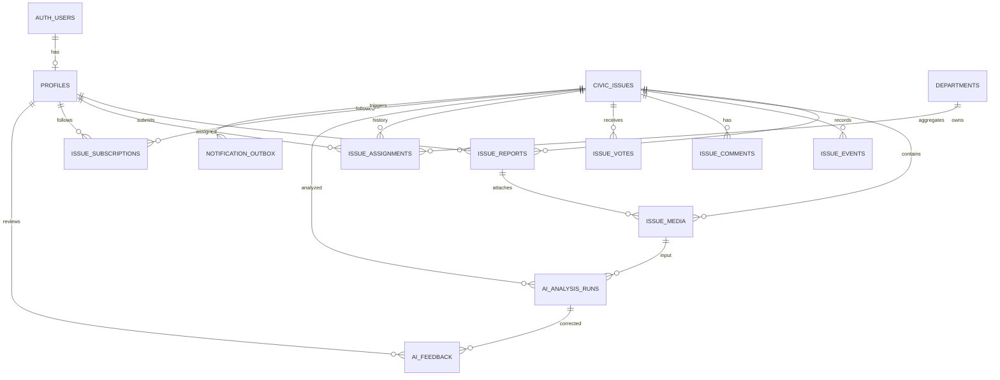

# CivicPulse AI — Database Design

**Status:** Target logical/physical design; current live schema must be migrated additively  
**Date:** 2026-10-30

## 1. Design goals

1. Supabase Postgres is the single source of truth for the deployed application.
2. Every citizen submission is preserved even when it merges into a nearby canonical issue.
3. All state transitions and staff decisions are auditable.
4. Geospatial duplicate detection and heatmaps use PostGIS indexes instead of loading the full dataset into the browser.
5. AI results are versioned/auditable but never authoritative for permissions or ticket closure.
6. Storage metadata is normalized in Postgres; files themselves live in Supabase Storage.
7. RLS defaults to least privilege. Service-role and AI-service tokens are never client-accessible.
8. New tables are introduced with additive migrations and rollback/compatibility steps; do not drop existing columns until all clients are migrated.

## 2. Existing live schema observed

The current Supabase project has these tables with RLS enabled:

| Table | Current purpose / key design |
|---|---|
| `profiles` | `id -> auth.users.id`, `display_name`, role enum `resident/staff/admin` |
| `civic_issues` | Canonical issue/ticket; UUID PK, defect type, description, priority 0–100, severity enum, status enum, PostGIS geography point, zone/landmark, confidence, report/duplicate counts, before/after image paths, AI JSON metadata, assigned staff, resolution timestamp |
| `issue_events` | Audit timeline with actor, event type, old/new status, note and JSON metadata |
| `issue_comments` | Comment records by issue and author |
| `issue_votes` | Composite PK `(issue_id, user_id)`, one vote per user per issue |
| `civic_api_rate_limits` | Bucket key, window start, request count |

Current ticket status enum is `Pending`, `Assigned`, `In Progress`, `Resolved`. Current defect categories include `pothole`, `garbage`, `sewage`, `streetlight`, and `unknown`. Do not write additional enum values until a migration has been explicitly applied.

## 3. ER diagram (target)

## 4. Core domain tables

### 4.1 `profiles` — existing
- `id uuid PK references auth.users(id)`
- `display_name text nullable`
- `role civic_user_role not null default 'resident'`
- `created_at`, `updated_at`
- Future additive fields: `preferred_locale`, `notification_preferences jsonb`, `is_suspended boolean`, `suspended_at timestamptz`.
- Resident self-service may edit safe profile fields only. Only an authorized admin action can update `role`.

### 4.2 `civic_issues` — existing canonical ticket
Keep current primary key and compatibility columns. Add later:
- `public_reference text unique` (human-friendly ticket number)
- `department_id uuid nullable`
- `sla_due_at timestamptz nullable`
- `published_at timestamptz nullable`, `moderation_status text`
- `priority_rule_version text`
- `duplicate_of_issue_id uuid nullable references civic_issues(id)` only if the team chooses a flattened canonical link; prefer preserving the individual reports table as the source of duplicate provenance.
- Keep `priority_score smallint CHECK 0..100`, `confidence numeric CHECK 0..1`, `location geography(Point,4326)`.
- `ai_metadata` remains a compatibility snapshot only; full runs live in `ai_analysis_runs`.

### 4.3 `issue_reports` — new, one row per resident submission
This table prevents duplicate merging from losing an individual report or image.
- `id uuid PK default gen_random_uuid()`
- `issue_id uuid not null references civic_issues(id)` — canonical ticket to which this submission is linked.
- `reporter_id uuid nullable references auth.users(id)` — nullable for anonymous reporting if product policy permits.
- `defect_type text not null`; `description text not null CHECK 5..2000 chars`
- `location geography(Point,4326) not null`; optional `landmark text`
- `submission_status text NOT NULL CHECK IN ('canonical','merged','needs_review','rejected','spam')`
- `idempotency_key text NOT NULL`; unique constraint scoped to intake caller/key so retry does not duplicate a submission.
- `created_at timestamptz not null default now()`
- `reviewed_by uuid nullable references profiles(id)`; `reviewed_at timestamptz`; optional `review_note text`.
- Indexes: `(issue_id, created_at desc)`, `(reporter_id, created_at desc)`, `GIST(location)`, unique idempotency key with the chosen scope.
- Access: public API only; no unrestricted table write from browser.

### 4.4 `issue_media` — new, metadata for Storage objects
- `id uuid PK`
- `issue_id uuid not null references civic_issues(id)`
- `report_id uuid nullable references issue_reports(id)`
- `uploaded_by uuid nullable references auth.users(id)`
- `bucket_id text not null`, `object_path text not null`
- `media_role text not null CHECK IN ('report_photo','repair_before','repair_after','public_thumbnail','other')`
- `content_type text not null`, `size_bytes bigint not null CHECK 0 < size_bytes <= configured limit`
- `width integer nullable`, `height integer nullable`, `sha256 text nullable`
- `visibility text not null CHECK IN ('private','public') default 'private'`; `moderation_status text not null default 'pending'`
- `created_at timestamptz default now()`; unique `(bucket_id, object_path)`.
- Indexes: `(issue_id, media_role, created_at desc)`, `(report_id)`.
- Migration note: keep the current `before_image_path` and `after_image_path` columns for compatibility, backfill into this table, update reads/writes, then deprecate them in a later release.

### 4.5 `issue_events` — existing append-only audit
Keep `issue_id`, actor, event type, old/new status, note, metadata, created time.
- Add event types only after an enum/check migration is deployed.
- Disallow public update/delete. Add trigger or service-only policy to make events append-only.
- Metadata must be JSON object, bounded in size, and stripped of secrets/PII.
- Index: `(issue_id, created_at asc)` and `(actor_id, created_at desc)`.

### 4.6 `issue_comments` — existing
- Current limits of 1–2000 characters are retained.
- Index `(issue_id, created_at asc)`.
- Public reads are allowed only for published/public issues; writes require an authenticated, non-suspended user and rate limit.
- Moderation/soft-delete can be added with `moderation_status`, `edited_at`, `deleted_at` without hard deletion of audit evidence.

### 4.7 `issue_votes` — existing
- Composite PK `(issue_id, user_id)` guarantees one vote per user.
- Aggregate counts are updated transactionally or calculated on a bounded query; never trust client-submitted counts.
- Index `(user_id, created_at desc)` for “my activity”.

### 4.8 `issue_assignments` — new history
- `id uuid PK`, `issue_id uuid FK`, `assignee_id uuid FK profiles`, `department_id uuid nullable FK departments`
- `assigned_by uuid FK profiles`, `assigned_at timestamptz`, `ended_at timestamptz nullable`, `note text nullable`
- Keep one active assignment per issue using a partial unique index where `ended_at is null`.
- Current `civic_issues.assigned_to` remains a denormalized active-assignee field for compatible queue reads; update it and history in the same transaction.

### 4.9 `departments` — new routing configuration
- `id uuid PK`, `code text unique`, `name text`, `active boolean`, `supported_defect_types text[]`, `created_at`, `updated_at`
- Optional future fields: municipality ID, contact address, escalation rule.
- No secret or provider credentials are stored here.

## 5. AI-specific tables

### 5.1 `ai_analysis_runs` — new, immutable model-call audit
- `id uuid PK`
- `request_id uuid unique`
- `issue_id uuid nullable FK civic_issues`; `report_id uuid nullable FK issue_reports`
- `task text CHECK IN ('image_triage','chat','repair_verification','translation','semantic_match')`
- `provider text`, `model text`, `provider_status text CHECK IN ('success','partial','unavailable','error')`
- `schema_version text`, `prompt_version text`
- `input_media_id uuid nullable FK issue_media`; `comparison_media_id uuid nullable FK issue_media`
- `result jsonb not null CHECK jsonb_typeof(result)='object'`
- `confidence numeric nullable CHECK 0..1`, `latency_ms integer nullable CHECK >=0`
- `input_tokens integer nullable`, `output_tokens integer nullable`, `error_code text nullable`, `created_at timestamptz default now()`.
- Never store API keys, raw bytes, full authorization headers or unnecessary raw prompts.
- Indexes: `(issue_id, created_at desc)`, `(task, provider_status, created_at desc)`.
- Default policy: no direct resident access. Staff can see sanitized result evidence through API; admin/operations can see safe metadata. Detailed provider traces stay server logs.

### 5.2 `ai_feedback` — new human correction loop
- `id uuid PK`, `analysis_run_id uuid FK ai_analysis_runs`, `issue_id uuid FK civic_issues`, `reviewer_id uuid FK profiles`
- `accepted boolean`, `corrected_defect_type text nullable`, `corrected_severity text nullable`, `review_note text nullable`, `created_at timestamptz`.
- Used for evaluation datasets and prompt/model regression tests; do not automatically fine-tune or change priority rules from individual feedback.

## 6. Notification and follow features

### 6.1 `issue_subscriptions`
- Composite PK `(issue_id, user_id)`.
- `email_enabled boolean default true`, `push_enabled boolean default false`, `created_at timestamptz`.
- A user may follow an issue to receive status/assignment/resolution notifications.
- RLS: user can manage only their own subscriptions.

### 6.2 `notification_outbox`
- `id uuid PK`, `recipient_id uuid nullable FK auth.users`, `issue_id uuid nullable FK civic_issues`
- `channel text CHECK IN ('in_app','email','push')`, `event_type text`, `payload jsonb CHECK object`
- `status text CHECK IN ('pending','processing','sent','failed','suppressed')`
- `attempt_count integer default 0`, `next_attempt_at timestamptz`, `sent_at timestamptz`, `last_error_code text`, `idempotency_key text unique`, `created_at timestamptz`.
- Provider-specific credentials live in secrets; worker retries use capped exponential backoff and dead-letter status.
- Future: `in_app_notifications` view/table may expose user-specific unread state without exposing outbox operations.

## 7. Spatial and analytics design

- Store coordinate points as `geography(Point,4326)`; validate latitude [-90,90] and longitude [-180,180].
- Create `GIST(location)` index on `civic_issues` and `issue_reports`.
- Duplicate candidate query: same normalized category, non-terminal/appropriate status, `ST_DWithin(location, candidate_location, radius_meters)`. The existing design uses a 15 m duplicate radius; make it configurable by category/municipality and test boundary cases.
- Do not merge based solely on distance. Return a duplicate *candidate* if confidence is uncertain; preserve the incoming report regardless.
- Index `civic_issues(status, priority_score DESC, created_at DESC)`, `(defect_type, status, created_at DESC)`, `(assigned_to, status, priority_score DESC)`, `issue_events(issue_id, created_at)`, and comments/events by issue/time.
- Heatmaps should use bounded spatial aggregation server-side, not send every ticket coordinate to the browser.
- If semantic similarity is introduced, store vectors in a separate table with model/version metadata (pgvector), and combine semantic similarity with location/category. Do not add embeddings until a supported embedding model/provider and retention policy are chosen.

## 8. RLS and privilege matrix

| Resource | Anonymous/public | Resident | Staff | Admin / service |
|---|---|---|---|---|
| Public ticket fields | Read published safe data | Same | Read queue and details | Full operational access |
| Ticket create | Via validated Edge API only | Via validated Edge API | Via API | Service writes |
| Comments | Read public comments | Add own comment; read public | Moderate under policy | Moderate/admin |
| Votes | No direct write | Upsert/delete own vote only via API | Same | Service aggregate |
| Assignments/status | None | None | Allowed operations in policy | Admin can reassign/override |
| Media originals | Public approved thumbnail only | Own media / public approved media | Authorized ticket evidence | Service access |
| AI run records | None | Minimal result attached to own/public issue | Sanitized assessment | Operations metadata |
| Issue events | Sanitized public events | Same + own history | Staff actions | Full safe audit |
| Notification outbox | None | Read own notification projection | Not globally readable | Worker/service only |

Current access is enforced partly by the Edge Function, which uses a server-side service-role client. Keep that boundary explicit. RLS still matters for any direct client query, new tables, and future refactors; service-role bypass must not be treated as a security policy.

## 9. Migration sequence

### Migration A — media and AI audit (additive)
1. Create `issue_reports`, `issue_media`, and `ai_analysis_runs`.
2. Add indexes and constraints.
3. Add restrictive RLS policies (deny direct table writes; expose only safe views or Edge API).
4. Backfill existing before/after image paths into `issue_media` with a reconciliation report.
5. Keep the original path columns until frontend/API writes and reads have moved.

### Migration B — assignment history and departments
1. Create `departments` and `issue_assignments`.
2. Backfill active assignments from `civic_issues.assigned_to`.
3. Update status/assignment mutations in a transaction; verify history against ticket snapshot.

### Migration C — subscriptions and outbox
1. Create `issue_subscriptions` and `notification_outbox`.
2. Only turn on delivery after an email/push adapter is configured and retries/idempotency are tested.

### Migration D — taxonomy and workflow
1. Introduce a reviewed category table or constrained category registry.
2. Add new workflow statuses only after UI, Edge Function and migration deploy in compatible order.
3. Add department/SLA rules and audited reopening/rejection states.

Each migration should pass on a clean local database and a restored production-schema snapshot before any production application. Do not reset the live database to “start from scratch.”

## 10. Retention, privacy, and backups

- Publicly published image thumbnails are separate from original private evidence.
- Signed URL lifetime is short; URLs are not persisted as data.
- Strip EXIF and sensitive metadata before public storage; keep only the minimum required metadata.
- Configure a retention period for rejected/spam reports and uploaded evidence; deletion must respect legal/audit requirements and be documented.
- Keep provider-generated responses only as needed for supportability; store a normalized result, not hidden chain-of-thought or entire raw conversation by default.
- Back up schema and data before migrations; export migration output and row counts. Verify restore by test project rather than assuming backups are usable.
