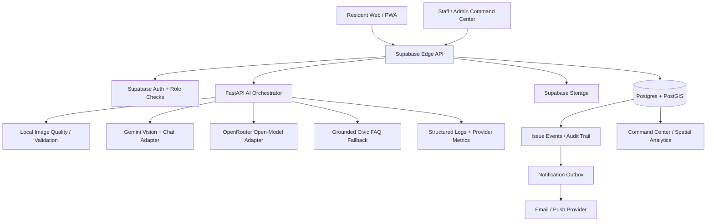

# CivicPulse AI — High-Level Design (HLD)

**Status:** Architecture proposal / rebuild baseline  
**Date:** 2026-10-30  
**Scope:** Resident-facing civic reporting, AI-assisted triage, duplicate detection, municipal operations, repair evidence, analytics, and notifications.

## 1. Executive decision

CivicPulse will use **Supabase Postgres/PostGIS as the single source of truth** for civic tickets, identity, comments, votes, events, and assignments. The React/Vite web app remains on Vercel. Supabase Edge Functions remain the public API façade and policy boundary. The existing FastAPI vision service becomes the single AI orchestration service for image analysis, civic help chat, and before/after repair comparison. The legacy Express/Mongoose API is not wired into production and must not become a second write path.

This is an incremental rebuild, not a destructive reset: keep the deployed app operational, introduce additive migrations, and route traffic to the vision service only after health checks and end-to-end tests pass.

## 2. Current-state audit

- **Frontend:** React 18 + Vite, deployed at https://civicpulse-ai-production.vercel.app.
- **Production data/API:** Supabase project `ccrhdrjywnaccthzyjte` and Edge Function `civicpulse-api`.
- **Existing database:** `profiles`, `civic_issues`, `issue_events`, `issue_comments`, `issue_votes`, and `civic_api_rate_limits`; issue location is PostGIS `geography`.
- **AI service:** `ai-vision-service/app/main.py` is FastAPI with image-quality checks, optional generic YOLO object context, and AI vision calls. It is not confirmed deployed. Its current reasoning path requires a configured provider key.
- **Legacy API:** `backend-service` uses MongoDB/Mongoose and is not the production source of truth.
- **Risk to remove:** the deployed Edge Function contains a direct keyless/community AI endpoint path. It is not a dependable production inference contract and must not make health checks claim that a model is live simply because an endpoint URL is configured.

## 3. Target architecture

The diagram shows target integrations. Optional providers, email, and push are unavailable until configured; their presence in the design is not a claim that they are already deployed.

## 4. Service responsibilities

### Web client (Vercel)
- Responsive resident reporting, camera/gallery upload, issue feed, map, filters, issue detail, comments, votes, and report status.
- Staff/admin command center with triage queue, assignment, status transitions, repair evidence review, audit timeline, and performance metrics.
- Shows the *actual* AI state: live provider result, partial/local-only, unavailable, or degraded. Never label a provider “online” based solely on a non-empty secret/URL.
- Never stores or calls provider secrets from the browser.

### Supabase Edge API
- Public HTTP entry point, CORS, payload validation, authentication and role authorization.
- Report/comment/vote/status/assignment persistence through Postgres and Storage.
- Rate limits, idempotency, deduplication coordination, audit events, and consistent response/error envelopes.
- Calls the AI service using a private service-to-service token. No LLM-specific code duplicated in the Edge Function.

### Postgres + PostGIS
- Canonical issue state, individual report submissions, user roles, assignment history, comments, votes, media metadata, AI run audit, and notification delivery state.
- Spatial queries and duplicate candidates using GIST-indexed geography.
- RLS enabled and default-deny for direct client access where server APIs own the operation.

### FastAPI AI orchestrator
- Enforces image limits and normalizes image orientation/format; computes image quality metrics locally.
- Exposes stable, typed tasks: `analyze`, `chat`, and `verify-resolution`.
- Routes by task and explicit provider policy with timeouts, bounded retries, structured JSON validation, output normalization, and truthful degraded responses.
- Logs provider/model/latency/status/request ID; never logs image bytes, secrets, or full private prompts.
- Treats model outputs as advice. It cannot independently assign staff, change ticket state, or close an issue.

## 5. Feature scope and priorities

### P0 — production-safe core
1. Email/password sign-in and resident/staff/admin roles.
2. Civic issue submission with category, description, actual coordinates, landmark, image, and upload validation.
3. Issue list/detail, map, filters, and category/status/priority sorting.
4. Duplicate-candidate detection by category and PostGIS radius; report frequency is retained.
5. Commenting, voting, and issue event/audit timeline.
6. Staff assignment and allowed status transitions.
7. Before/after evidence upload and staff-confirmed resolution.
8. AI health that distinguishes configured, live, degraded, and unavailable.
9. Rate limits, strict validation, storage access policy, and automated tests.

### P1 — operational intelligence
- AI vision triage: likely defect category, observed evidence, uncertainty, suggested action, severity estimate, and manual-review flag.
- Explainable priority score using documented, versioned deterministic rules alongside—not instead of—AI results.
- Duplicate cluster UI, ward/zone rollups, heatmap, aging/SLA indicators, department queue, export, and staff workload.
- User subscriptions to an issue, in-app/email notifications, and status change alerts.
- Staff review of AI predictions and an audit of corrections.

### P2 — opt-in enhancements
- Multilingual report descriptions and localized help chat.
- Voice-to-text for reports, semantic search/related issues, smart routing to departments, accessibility improvements, offline draft queue, analytics export, and public trend dashboards.
- CAPTCHA/abuse scoring, moderation queue, configurable municipalities and service areas, and a formal model evaluation pipeline.
- Optional native mobile shell only if PWA capabilities prove insufficient.

## 6. Non-functional requirements

- **Correctness:** AI returns a typed result with schema version and provenance; null/failed model results remain null, not fabricated detections.
- **Security:** secrets stay server-side; all staff operations require a verified user and role check; no AI output may bypass authorization.
- **Privacy:** strip EXIF; avoid sending people, license plates, or sensitive details to third-party providers. Public/free inference routes must be opt-in and must not receive confidential/personal images. Keep evidence storage private by default in the target design.
- **Resilience:** local quality check and manual review remain available when model inference is down; provider timeouts are bounded and circuit-breaker/backoff behavior prevents retry storms.
- **Observability:** request ID, route, provider, model, result status, latency and safe error code; never store raw base64 or provider API keys in logs.
- **Performance:** resize client-side and server-side; limit bytes/pixels; paginate issue lists; use spatial and compound indexes; avoid loading all issue histories in one response.
- **Accessibility:** keyboard navigation, visible focus, form labels, screen-reader status, color-independent severity indicators, and mobile-friendly targets.
- **Auditability:** state changes, assignment, verification decisions, and AI-assisted actions are immutable event records with actor and timestamp.

## 7. Trust boundaries and secrets

- Browser has only the Supabase publishable/anon key and public configuration.
- Supabase service-role key remains a managed runtime secret, never a `VITE_*` variable.
- `AI_SERVICE_TOKEN` and provider keys live only in the AI service host's secret store.
- Public report intake is rate-limited and validated; staff-only routes check user claims/profile role on the server.
- Provider health is an actual bounded health probe with last-success time and capability status. “Configured” is not equal to “working.”

## 8. Deployment topology

- **Vercel:** static React SPA, root `frontend-app`.
- **Supabase:** Auth, Postgres/PostGIS, Storage, Edge Function, runtime secrets.
- **Container host:** FastAPI vision service. Render Blueprint exists as a starting point, but its free service has cold starts and is not an SLA-backed production service. It is suitable for a student/demo project; production uptime needs a suitable plan.
- **CI:** build/lint/unit tests, migration checks, API contract tests, then preview deployment. Production deployment follows smoke tests.
- **No dual writes:** the old Mongo API stays a legacy/local component until there is a separately approved migration.

## 9. Rollout and rollback

1. Freeze the currently working production behavior; export schema and check deployed source.
2. Merge design docs and provider adapter work without changing the public frontend contract.
3. Add database tables/indexes through additive, reversible migrations.
4. Deploy FastAPI and pass `/health`, authenticated `/analyze`, `/chat`, and `/verify-resolution` tests on synthetic/test images.
5. Store service URL/token as secrets, then enable AI behind a feature flag.
6. Run end-to-end test matrix and compare a shadow sample against manual labels.
7. Enable by task gradually. Roll back to local quality + manual review if provider health or error budget degrades.

## 10. Acceptance criteria

- There is exactly one production source of truth for issue state.
- Each report persists even if AI inference fails; the response clearly says analysis is partial/unavailable.
- No UI claims that AI is ready without a real health probe and required task capability.
- AI outputs validate against schema and cannot close tickets or change permissions.
- Repair verification is advisory; staff must confirm.
- Duplicate submissions preserve their own evidence and reporter context while linking to a canonical issue.
- All required service secrets are absent from source control and browser bundles.
- CI tests cover provider failure, invalid JSON, timeouts, missing keys, duplicate issue races, permissions, status transitions, and image validation.
